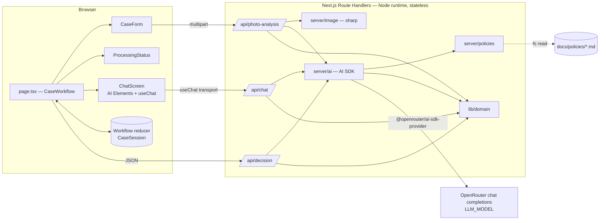
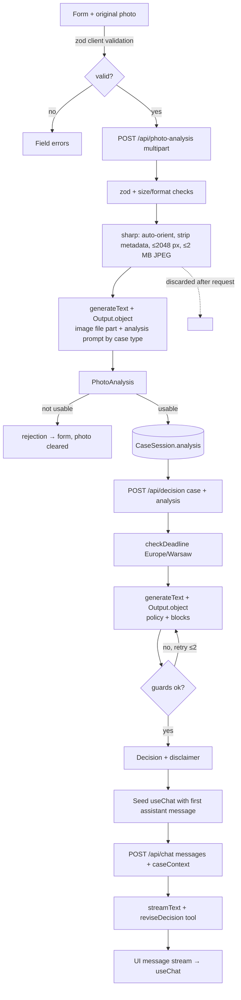
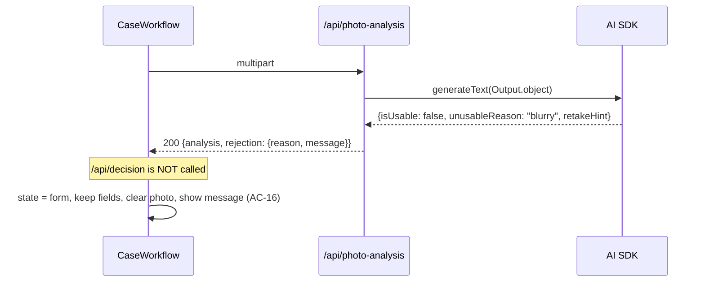
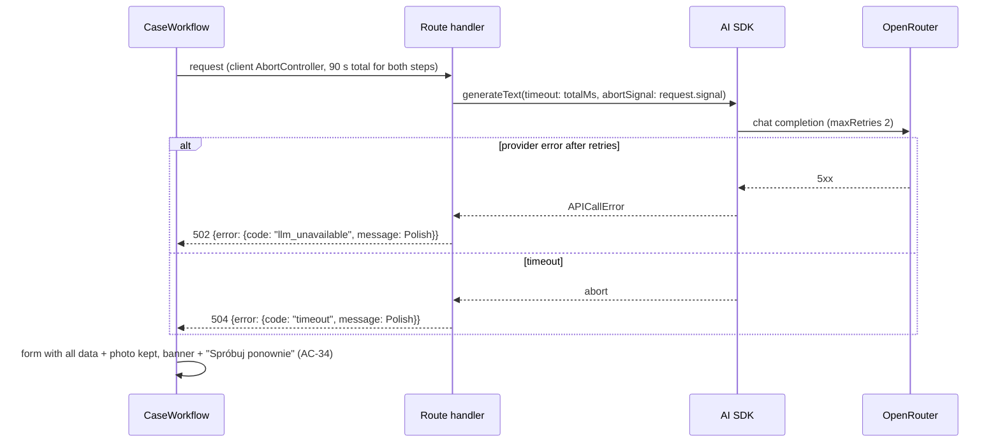
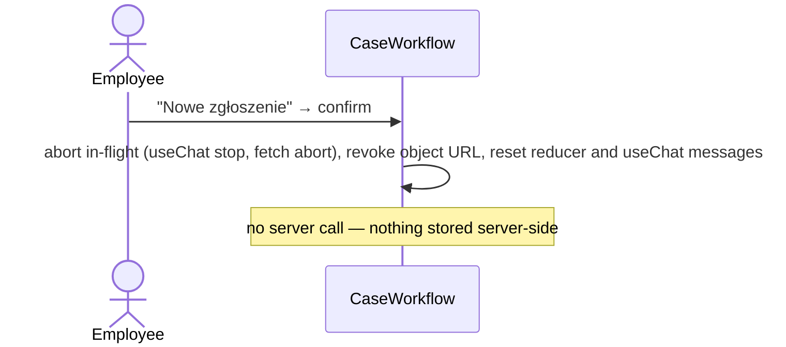

# ADR: Hardware Service Decision Copilot — Main Architecture

**Date:** 2026-10-18
**Status:** Accepted (supersedes the FastAPI + React variant of 000–003 from the same date; see Git history)
**PRD:** [`docs/PRD.md`](../PRD.md)

---

## 1. Overview

Hardware Service Decision Copilot is an MVP web app in which a support employee submits a complaint or return case (form + one photo). A multimodal LLM describes the photo, a second LLM call applies the company policy and recommends a decision, and the employee continues in a streamed chat with the agent. The PRD defines behaviour and acceptance criteria (AC-01…AC-40). This ADR set defines how it is built with **Next.js (App Router), TypeScript strict, the Vercel AI SDK and OpenRouter**.

| File | Area |
|---|---|
| `000-main-architecture.md` (this file) | Evaluation of the candidate libraries, stack, layout, endpoint map, cross-cutting decisions, diagrams, overall test strategy |
| [`001-project-setup.md`](001-project-setup.md) | Initialising the project from the empty `app/` folder, tooling, strict TypeScript, environment, scripts |
| [`002-ai-pipeline.md`](002-ai-pipeline.md) | Route handlers, image processing, AI SDK + OpenRouter usage, prompts, structured outputs, guards, chat streaming |
| [`003-frontend-chat-ui.md`](003-frontend-chat-ui.md) | Screens, state machine, AI Elements chat components, `useChat` wiring, styling from brand tokens |

---

## 2. Technology Documentation References

Context7 IDs were resolved and queried on 2026-10-18; implementing agents query them directly.

| Library | Context7 ID or official docs | Used for |
|---|---|---|
| AI SDK (core + UI) | `/vercel/ai` | `generateText`, `streamText`, `Output.object`, file (image) parts, `tool`, `isStepCount`, `createUIMessageStream`, `createUIMessageStreamResponse`, `toUIMessageStream`, `convertToModelMessages`, `UIMessage`, `MockLanguageModelV4` / `simulateReadableStream` (`ai/test`), `timeout`, `abortSignal` |
| AI SDK React | `/vercel/ai` (package `@ai-sdk/react`) | `useChat`, `DefaultChatTransport`, `prepareSendMessagesRequest` |
| OpenRouter AI SDK provider | `/openrouterteam/ai-sdk-provider`; guide https://openrouter.ai/docs/guides/community/vercel-ai-sdk | `createOpenRouter`, chat model, `providerOptions.openrouter` (reasoning), `structuredOutputs`, image → `image_url` conversion |
| OpenRouter | `/websites/openrouter_ai`; https://openrouter.ai/docs | Model catalogue, image inputs, structured outputs, errors |
| Next.js | `/vercel/next.js` (v16.2.x) | App Router, Route Handlers (Node.js runtime), `create-next-app` |
| AI Elements | `/vercel/ai-elements` | `Conversation`, `Message`, `MessageResponse`, `PromptInput` chat components |
| shadcn/ui | `/shadcn-ui/ui` | Base components required by AI Elements; `shadcn init` |
| Tailwind CSS v4 | `/tailwindlabs/tailwindcss.com` | Styling, `@theme` brand tokens |
| sharp | `/lovell/sharp` | Content-based format detection, auto-orient, resize, JPEG re-encode, metadata stripping |
| Zod | https://zod.dev | Request and LLM output schemas (≥ 4.1.8 per AI SDK troubleshooting guide) |
| Vitest | `/vitest-dev/vitest` | Unit + integration tests |
| React Testing Library / user-event | `/testing-library/react-testing-library`, `/testing-library/user-event` | Component tests |
| Playwright | `/microsoft/playwright` | E2E against the real stack; manual QA via `playwright-cli` |
| assistant-ui (evaluated, not used) | `/assistant-ui/assistant-ui` | — |

---

## 3. Evaluation of Candidate Options

Sources read on 2026-10-18: the AI SDK docs via Context7 `/vercel/ai`, https://chat-sdk.dev/, https://openrouter.ai/docs/api_reference/responses/overview (+ basic usage), https://openrouter.ai/docs/guides/community/vercel-ai-sdk, the provider README (github.com/OpenRouterTeam/ai-sdk-provider), AI Elements and assistant-ui docs via Context7.

| Option | What it is today (verified) | Fit for this PRD | Verdict |
|---|---|---|---|
| **Vercel AI SDK** (`ai`, `@ai-sdk/react`) | v7 line: Node ≥ 22. `streamText` + `useChat` with UI message streams (`createUIMessageStreamResponse` + `toUIMessageStream`); images as `file` parts with an image media type; structured output via `Output.object` (`generateObject`/`streamObject` are deprecated); typed tools rendered as `tool-<name>` parts; mock models in `ai/test`; `timeout` with `totalMs`/`chunkMs`. | Covers every AI need: one-shot structured photo analysis, structured decision, streamed chat with a tool for decision changes, offline tests. | **Use** — core of the solution. |
| **Chat SDK** (chat-sdk.dev) | Now "a unified TypeScript SDK for building chat bots and agents" for **Slack, Teams, Google Chat, Discord, Telegram, WhatsApp**, with platform/state adapters. It is not a Next.js web-chat template. | PRD needs a browser form + in-app chat; no messaging platforms (PRD §7 excludes integrations). A full chatbot app template would also bring auth, DB and chat history, all out of scope. | **Reject.** |
| **OpenRouter Responses API** (`/api/v1/responses`) | OpenAI-compatible, **stateless** (`store: true` / `previous_response_id` → 400), streaming via SSE events, reasoning, tools. The pages read do not document image input or JSON-schema output for this endpoint. | Works only with hand-written HTTP + SSE parsing, or an OpenAI provider pointed at OpenRouter; we would lose `useChat` integration and typed outputs. Statelessness gives no advantage over chat completions here. | **Reject for MVP** (review trigger in D3). |
| **OpenRouter provider for the AI SDK** (`@openrouter/ai-sdk-provider`) | Official provider; current line supports `ai@^7`, Node ≥ 22, ESM-only (legacy: 2.9.1 for AI SDK 6, 1.5.4 for AI SDK 5). Reads `OPENROUTER_API_KEY` by default; uses OpenRouter chat completions; converts image `file` parts to `image_url`; `providerOptions.openrouter.reasoning`; `structuredOutputs` model setting; usage/cost metadata. | Exactly the bridge we need: AI SDK APIs on top of the `OPENROUTER_API_KEY` + `LLM_MODEL` from `.env.example`. | **Use.** |
| **AI Elements** | shadcn/ui-based component registry (copied into the repo), designed for `useChat`: `Conversation` (auto-scroll), `Message`/`MessageResponse` (streaming Markdown), `PromptInput`. Needs React 19, Tailwind 4, shadcn. | Streaming chat out of the box, full styling control for the brand, renders our custom data/tool parts with our own components. | **Use** for the chat screen. |
| **assistant-ui** | Library with its own runtime (`useChatRuntime`, `AssistantChatTransport`) and a ready `Thread`. | Viable, but its runtime owns chat state; seeding the decision as the first message, rendering decision-change tool parts and the side panel means working around the abstraction. | **Reject** (heavier than needed). |

**Recommended approach:** Next.js App Router + AI SDK (core + `useChat`) + `@openrouter/ai-sdk-provider` on OpenRouter chat completions + AI Elements for the chat UI. The form → photo analysis → decision steps use two non-streamed JSON route handlers (structured output, guards, deterministic stages). The chat uses `streamText` → UI message stream → `useChat`.

---

## 4. System Architecture

### Architecture pattern

**Next.js full-stack monolith** in `app/`: React client components for the UI and Route Handlers (Node.js runtime) as a **stateless** backend. No database (PRD §7). All case state lives in the browser tab.

### Repository structure (inside `app/`, created as described in ADR-001)

```
app/
  AGENTS.md                      Generated by create-next-app; extended with project commands
  package.json  tsconfig.json  next.config.ts  components.json  vitest.config.ts  playwright.config.ts
  .env.local                     Local secrets (gitignored), copied from repo-root .env.example
  src/
    app/
      layout.tsx  page.tsx  globals.css         One page: the case workflow
      api/photo-analysis/route.ts               POST multipart → PhotoAnalysis JSON
      api/decision/route.ts                     POST JSON → Decision JSON
      api/chat/route.ts                         POST useChat body → UI message stream
    features/
      case-form/   processing/   chat/          UI by screen (ADR-003)
      workflow/                                  State machine + controller hook
    components/
      ui/            shadcn/ui (generated)
      ai-elements/   AI Elements (generated)
    lib/
      domain/        Shared, isomorphic: enums, labels, limits, zod schemas, deadlines
      i18n/pl.ts     All Polish UI strings
    server/          Server-only (imports `server-only`)
      ai/            model factory, photo analyst, decision, chat, guards, context blocks
      prompts/       *.md prompt files
      policies.ts    Loads docs/policies/*.md
      image.ts       sharp pipeline
      errors.ts      Error → HTTP/stream mapping
  tests/fixtures/captures/        Real LLM outputs (for mocks)
  e2e/                            Playwright specs
docs/policies/                    Policy documents (read at runtime)
assets/example-images/            Real photos for E2E and manual QA
```

### Technology stack

| Layer | Technology | Reason |
|---|---|---|
| Framework | Next.js 16 App Router, React 19 | Agreed stack; UI and API in one project; Route Handlers support streaming responses. |
| Language | TypeScript, `strict: true` + extra strict flags (ADR-001) | Agreed; catches contract mismatches between client and server at compile time. |
| AI orchestration | AI SDK v7 (`ai`, `@ai-sdk/react`) | Structured output, image parts, streaming chat, tools, test mocks (§3). |
| LLM gateway | OpenRouter via `@openrouter/ai-sdk-provider`, one model `LLM_MODEL` | Uses the repo's `.env.example`; user decision: a single multimodal reasoning model for all roles. |
| Chat UI | AI Elements on shadcn/ui | Streaming chat components owned in-repo (§3). |
| Styling | Tailwind CSS v4 with `@theme` from `assets/design-tokens.json` | Brand tokens become utilities. |
| Image processing | sharp (Node runtime) | Fast, content-based format detection, metadata stripped by default. |
| Validation | Zod schemas shared by client and server | One definition of limits and shapes. |
| Tests | Vitest + RTL + user-event; Playwright | Fast unit/integration; real-browser E2E. |
| Package manager | npm | Present with Node 24; no extra install. |
| Runtime | Local only (`npm run dev` / `npm run build && npm start`), Node ≥ 22 | User decision; AI SDK 7 requires Node 22+. |

---

## 5. Module Structure & Dependencies

| Module | Responsibility | Depends on | Used by |
|---|---|---|---|
| `lib/domain` | `CaseType`, `Category` (9), `DecisionCode` (4) with Polish labels; limits; zod schemas for `CaseInput`, `PhotoAnalysis`, `Decision`, chat body; `checkDeadline()` | zod | everything |
| `lib/i18n` | Polish strings | — | features, server error messages |
| `server/image` | Validate size/format, auto-orient, strip metadata, resize, re-encode ≤ 2 MB | sharp, `lib/domain` | `api/photo-analysis` |
| `server/policies` | Read both policy files once per process | node:fs, env | `server/ai` |
| `server/ai` | Model factory, photo analyst, decision maker, chat stream, guards, context blocks, prompt loader | `ai`, provider, `lib/domain`, `server/policies` | route handlers |
| `server/errors` | Map errors to status + Polish message (AC-39) | `lib/i18n` | route handlers |
| `app/api/*` | HTTP boundary: parse, validate, call `server/*`, respond | `server/*`, `lib/domain` | browser |
| `features/workflow` | Reducer state machine + controller hook (fetch, abort, timeouts) | `lib/*` | `app/page.tsx` |
| `features/case-form`, `processing`, `chat` | Screens | `components/*`, `lib/*`, `@ai-sdk/react` | `app/page.tsx` |
| `components/ui`, `components/ai-elements` | Generated primitives | shadcn deps | features |

Direction: `app/api → server → lib`; `app/page → features → (components, lib)`. `lib` imports neither `server` nor React. Every file in `server/` imports `server-only`, so a client import fails the build.

---

## 6. Data Models

| Model | Purpose | Key fields | Where | Lifetime |
|---|---|---|---|---|
| `CaseInput` | Form data | `caseType`, `category`, `modelName`, `purchaseDate` (ISO date), `description` | Browser state; sent to all three endpoints | Tab |
| Photo | Uploaded image | original `File` (browser), compressed JPEG `Buffer` (server) | Browser memory; server request scope only | Original: tab. Compressed: one request, never stored or returned |
| `PhotoAnalysis` | Structured vision output | see ADR-002 §4.1 | Server → browser → sent back to decision/chat | Tab |
| `DeadlineCheck` | Deterministic deadline facts | `today`, `daysSincePurchase`, `limitLabel`, `exceeded`, `policySection` | Computed server-side on every request | Request |
| `Decision` | Recommendation | `decision` (`ACCEPTED`/`REJECTED`/`INSPECTION_REQUIRED`/`ESCALATED`), `policyRefs[]`, `contradictionDetected`, `messageMarkdown` (with disclaimer) | Server → browser | Tab |
| `ChatUIMessage` | `UIMessage` typed with a `decision` data part and the `reviseDecision` tool | `id`, `role`, `parts[]` | `useChat` state; full list sent on each chat request | Tab |
| `CaseSession` | Everything for one case | `case`, `photo`, `analysis`, `initialDecision`, `currentDecision`, chat messages | Workflow reducer + `useChat` | Until reload / "Nowe zgłoszenie" |

---

## 7. API / Interface Contracts (summary — details in ADR-002)

| Step (PRD) | Endpoint | Input | Output | Errors |
|---|---|---|---|---|
| Analyse photo (stage "Analiza zdjęcia") | `POST /api/photo-analysis` | `multipart/form-data`: case fields + `photo` | `200 {analysis: PhotoAnalysis, rejection: null \| {reason, message}}` | 422 field errors, 413, 415, 502, 504 |
| Decide (stage "Przygotowanie decyzji") | `POST /api/decision` | JSON `{case, analysis}` | `200 {decision: Decision}` | 422, 502, 504 |
| Chat | `POST /api/chat` | `useChat` body `{id, messages}` + `{caseContext: {case, analysis, currentDecision}}` | UI message stream (SSE) consumed by `useChat` | 422 (JSON before stream), stream `error` part |

No authentication (PRD §7). Responses carry `Cache-Control: no-store`. All handlers set `export const runtime = 'nodejs'`.

---

## 8. Environment Variables

Next.js loads env files from the project directory `app/`. Developers copy the repo-root `.env.example` to `app/.env.local`.

| Variable | Purpose | Required | Example value |
|---|---|---|---|
| `OPENROUTER_API_KEY` | OpenRouter key (read by the provider by default) | Yes | `sk-or-v1-…` |
| `LLM_MODEL` | OpenRouter model ID for photo analysis, decision and chat. Must accept image input and support structured outputs (check on https://openrouter.ai/models before use) | Yes | value from `.env.example` |
| `LLM_TIMEOUT_SECONDS` | Per-request model time budget | No (default `90`) | `90` |
| `POLICIES_DIR` | Folder with `return-policy.md`, `complaint-policy.md` | No (default `../docs/policies` relative to `app/`) | `../docs/policies` |

The server fails fast (clear error on first request and in `npm run check:env`, ADR-001) when the key or model is missing or a policy file is missing/empty. Variables are never prefixed `NEXT_PUBLIC_`.

---

## 9. Technical Decisions

### D1 — Next.js App Router monolith with AI SDK + OpenRouter provider
**Status:** Accepted
**Date:** 2026-10-18
**Context:** The group chose Next.js + TypeScript and the AI SDK; the repo standardises on `OPENROUTER_API_KEY`/`LLM_MODEL`.
**Decision:** One Next.js project in `app/`; Route Handlers on the Node.js runtime; AI SDK v7 with `@openrouter/ai-sdk-provider`.
**Rejected alternatives:**
- FastAPI + React (previous ADR variant): superseded by the group's stack choice.
- OpenRouter Responses API directly: no AI SDK/`useChat` integration, image/structured-output support not documented for that endpoint (§3).
**Consequences:**
- (+) One language, shared zod schemas client/server, first-class streaming chat.
- (-) Bound to the provider's support for the chosen model's features (image input, JSON schema).
**Review trigger:** If OpenRouter's Responses API gains an official AI SDK provider with clear advantages, or the model lacks structured outputs via chat completions.

### D2 — Two JSON steps for analysis/decision, streaming only for chat
**Status:** Accepted
**Date:** 2026-10-18
**Context:** PRD needs visible stages (AC-24), an unusable-photo exit before any decision (AC-16) and hard rules on the decision (AC-19/20/21/23) that must be enforced before the employee sees it.
**Decision:** The client calls `POST /api/photo-analysis` then `POST /api/decision`; each returns validated JSON produced with `generateText` + `Output.object`. The stage shown is the request in flight. Only the chat uses `streamText` + `useChat`.
**Rejected alternatives:**
- One streamed endpoint emitting data parts for stages and streamed decision text: a guard failure after text was streamed would need retracting text; adds a custom stream reader for a non-chat flow.
- Feeding the photo into `useChat` as the first user message: the base64 photo would be resent with every chat turn and stored in chat state.
**Consequences:**
- (+) Deterministic, easily testable steps; guard retries happen before display; the photo is sent once.
- (-) The first decision appears all at once (processing indicator covers the wait, as the PRD describes).
**Review trigger:** If the decision step regularly exceeds ~20 s and users want to see it being written.

### D3 — Single model from `LLM_MODEL`
**Status:** Accepted
**Date:** 2026-10-18
**Context:** User decision: one variable as in `.env.example`. The ID in `.env.example` could not be confirmed in the public model list on 2026-10-18.
**Decision:** All three calls use `LLM_MODEL`. Before implementation, the agent confirms on openrouter.ai/models that the model lists image input and structured outputs, and records the verified ID and date in `app/AGENTS.md`.
**Rejected alternatives:**
- Separate vision and reasoning models: more config; not requested.
**Consequences:**
- (+) Simple config.
- (-) The model must be multimodal *and* good at reasoning; cost per chat turn equals a multimodal model.
**Review trigger:** If the chosen model fails the capability check or decision quality is poor in manual QA.

### D4 — Stateless server; case context sent by the client
**Status:** Accepted
**Date:** 2026-10-18
**Context:** No persistence in MVP; session ends with the tab (AC-37).
**Decision:** The client keeps `CaseSession`; `/api/decision` receives `{case, analysis}`, `/api/chat` receives `caseContext` + all messages (via `prepareSendMessagesRequest`). The photo is never resent.
**Rejected alternatives:**
- Server memory sessions: lost on restart, needs IDs and eviction.
**Consequences:**
- (+) Restartable server; DB can be added later behind the same contracts.
- (-) A client could tamper with `analysis`/`currentDecision`; acceptable for an internal tool without auth; deadlines are always recomputed server-side (D5).
**Review trigger:** When session logging or auth is added.

### D5 — Deterministic deadlines and guards in code
**Status:** Accepted
**Date:** 2026-10-18
**Context:** LLMs make date arithmetic mistakes; AC-19/20/21/23 must always hold.
**Decision:** `checkDeadline()` (Europe/Warsaw) feeds facts to the model; guards validate the structured decision and the `reviseDecision` tool input; violations trigger a corrective retry (max 2) or tool rejection (ADR-002).
**Rejected alternatives:**
- Prompt-only rules: not verifiable.
**Consequences:**
- (+) Unit-testable compliance.
- (-) Deadline numbers duplicated in code and policy text (pinned by a test).
**Review trigger:** When policies become editable without a deploy.

### D6 — AI Elements for the chat UI
**Status:** Accepted
**Date:** 2026-10-18
**Context:** Need a streaming chat with Markdown, auto-scroll and an input, styled to the brand.
**Decision:** AI Elements (`Conversation`, `Message`, `MessageResponse`, `PromptInput`) wired to `useChat`; custom parts (decision badge, decision change) rendered by our components.
**Rejected alternatives:**
- assistant-ui: own runtime and state, harder to seed the first message and side panel.
- Hand-built chat: re-implements scroll and streaming Markdown.
**Consequences:**
- (+) Components live in the repo and can be restyled.
- (-) Adds shadcn/ui and its dependencies.
**Review trigger:** If AI Elements components block brand or accessibility requirements.

### D7 — Image compression with sharp on the server
**Status:** Accepted
**Date:** 2026-10-18
**Context:** AC-13 (≤ 2048 px, ≤ 2 MB); photos may contain personal data and EXIF GPS; `assets/example-images/laptop-1.png` is JPEG content with a `.png` name.
**Decision:** sharp detects the real format from content, auto-orients, resizes inside 2048×2048 without enlargement, re-encodes JPEG without metadata, lowering quality/size until ≤ 2 MB. All in memory.
**Rejected alternatives:**
- Browser-side compression: untrusted, duplicates logic.
**Consequences:**
- (+) One testable place; EXIF never reaches the LLM.
- (-) Native dependency (prebuilt binaries for Linux/macOS/Windows).
**Review trigger:** If deployment moves to an environment without sharp binaries.

---

## 10. Diagrams

### 10.1 Architecture / Component Diagram



### 10.2 Data Flow Diagram



### 10.3 Sequence Diagrams

#### Form → photo analysis → decision → chat (happy path)

```mermaid
sequenceDiagram
    actor E as Employee
    participant UI as CaseWorkflow (client)
    participant PA as /api/photo-analysis
    participant DE as /api/decision
    participant AI as AI SDK + OpenRouter
    E->>UI: Fill form, attach photo, "Analizuj zgłoszenie"
    UI->>UI: zod validation; state = processing(stage: photo)
    UI->>PA: multipart (case + photo), AbortSignal (90 s budget)
    PA->>PA: validate, sharp compress
    PA->>AI: generateText(Output.object PhotoAnalysis, image part)
    AI-->>PA: PhotoAnalysis
    PA-->>UI: 200 {analysis, rejection: null}
    UI->>UI: stage = decision
    UI->>DE: {case, analysis}
    DE->>DE: checkDeadline
    DE->>AI: generateText(Output.object DecisionDraft, policy)
    AI-->>DE: DecisionDraft
    DE->>DE: guards ok, append disclaimer
    DE-->>UI: 200 {decision}
    UI->>UI: seed useChat messages = [assistant decision message]; state = chat
```

#### Unusable photo



#### Model failure / timeout



#### Chat turn with decision change

```mermaid
sequenceDiagram
    actor E as Employee
    participant C as ChatScreen (useChat)
    participant CH as /api/chat
    participant AI as streamText + reviseDecision tool
    E->>C: message + Enter
    C->>CH: {id, messages, caseContext} (prepareSendMessagesRequest)
    CH->>CH: zod validate, checkDeadline
    CH->>AI: streamText(system + policy + blocks, convertToModelMessages(messages), tools, stopWhen isStepCount(3))
    AI-->>C: text deltas (UI message stream)
    AI->>AI: tool call reviseDecision{to, reason}
    AI->>AI: execute → guards → {accepted: true, from, to}
    AI-->>C: tool-reviseDecision part (output-available)
    AI-->>C: final text
    CH-->>C: disclaimer text part (because change accepted)
    C->>C: currentDecision = to; summary badge updates (AC-30)
```

#### New case



---

## 11. Testing Strategy

### Philosophy

TDD per `AGENTS.md`: write a failing test from the PRD/ADR, see it fail for the right reason, implement the minimum, refactor green. Mock policy per `AGENTS.md`: **unit** — all dependencies mocked; **integration** — only the LLM replaced (`MockLanguageModelV4` injected through the model factory), everything else real (route handler, sharp, zod, policy files); **E2E** — nothing mocked, real OpenRouter. Mock outputs are derived from **captured real responses**: `npm run capture:llm` (ADR-002) runs the real model on `assets/example-images/*` and saves outputs verbatim with date, model ID and inputs in `tests/fixtures/captures/`.

### Test layers

| Layer | Type | Scope | Tools |
|---|---|---|---|
| Unit | Unit | `lib/domain` (schemas, deadlines), guards, prompt/context assembly, image pipeline helpers, reducer, form validation | Vitest (node / jsdom) |
| Component | Unit | Form, processing, chat screen with mocked `fetch`/transport | Vitest + RTL + user-event |
| Integration | Integration | Route handlers called with real `Request` objects; real sharp and policy files; LLM = `MockLanguageModelV4` replaying captures | Vitest (node) |
| E2E | E2E | Built app + real OpenRouter; `assets/example-images` | Playwright |
| Manual QA | Manual | Every touched screen; screenshots vs `assets/homepage.png` + `docs/design-guidelines.md` | `playwright-cli` |

### Key test scenarios

| Scenario | Tested | Input | Expected | Edge cases |
|---|---|---|---|---|
| Complaint happy path | Full flow | Smartfon, `phone-1.jpg`, description ≥ 10 chars | Analysis → decision → chat seeded; 1 of 4 decisions; ≥ 1 policy ref; disclaimer once at end | — |
| Return deadline | AC-19 | Purchase 15 days ago; mock tries ACCEPTED first | REJECTED after guard retry | Exactly 14 days → allowed |
| Complaint deadline | AC-20 | 2 years + 1 day | REJECTED, ref "pkt 2.3" | 29 Feb purchase |
| Contradiction | AC-21 | `contradictionDetected: true`, mock ACCEPTED | Retry → not ACCEPTED | ESCALATED passes |
| Unusable photo | AC-16 | Capture with `isUsable: false` | `rejection` set; client never calls `/api/decision` | category mismatch |
| Format by content | D7 | `laptop-1.png` | Processed as JPEG | `laptop-2.webp` |
| Bad file | AC-08/09 | text bytes named `.jpg`; 10 MB + 1 byte | 415; 413 | exactly 10 MB non-image → 415 |
| Compression | AC-13 | `laptop-1.png` 3024×3135 | ≤ 2048 px, ≤ 2 MB, JPEG, no EXIF | `phone-2.jpeg` not enlarged |
| Chat context | AC-29 | 6-message history | Model receives system blocks + all messages in order | 41 messages → 422 |
| Decision change | AC-30/31 | Mock calls `reviseDecision` | Tool part + disclaimer; panel updates | Revision to ACCEPTED with exceeded deadline → tool output `accepted: false` |
| LLM failure | AC-34/35 | Mock throws / delays | 502/504 with Polish message; chat error state | — |
| New case | AC-36 | Confirm during streaming | Stream aborted; empty form; next request has no old data | — |

### Technical acceptance criteria

- **TAC-01** `npm run typecheck`, `npm run lint`, `npm test` and `npm run build` finish with zero errors and zero warnings.
- **TAC-02** The default `npm test` run makes no network calls (a test setup fails any `fetch` to `openrouter.ai`).
- **TAC-03** `npm run test:e2e` passes against `npm run build && npm start` with a valid key and uses no `page.route` mocks.
- **TAC-04** No file under `src/server/` can be imported by a client component (each imports `server-only`; `npm run build` fails otherwise).
- **TAC-05** No uploaded or processed image is written to disk; no log line contains the description, chat text, image bytes or the API key (integration tests capture console output).
- **TAC-06** `OPENROUTER_API_KEY` and `LLM_MODEL` do not appear in the client bundle (`.next/static` grep in CI script `npm run check:bundle`).
