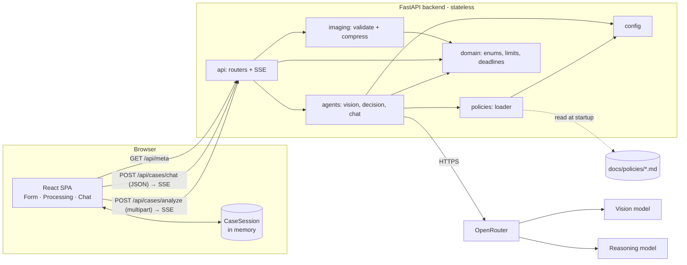
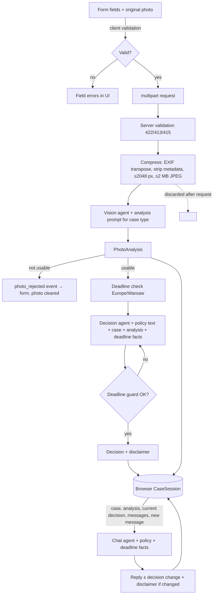
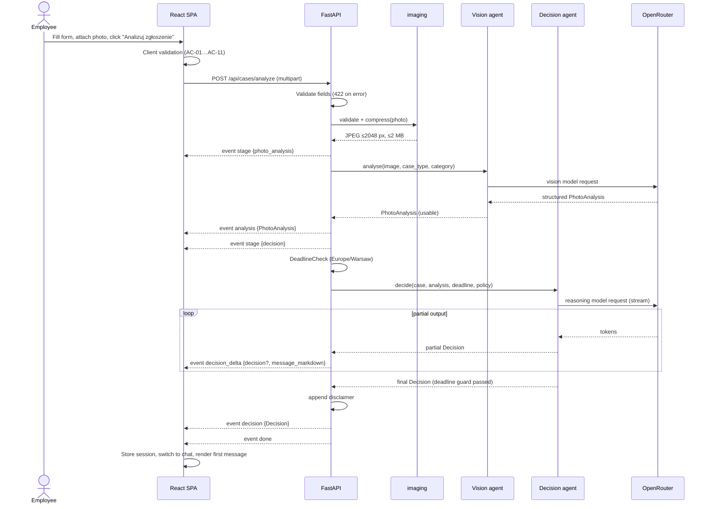
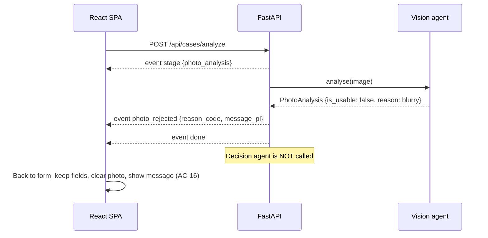
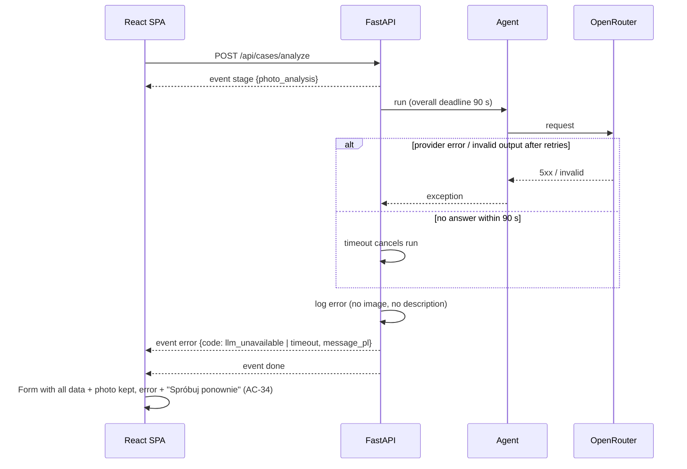
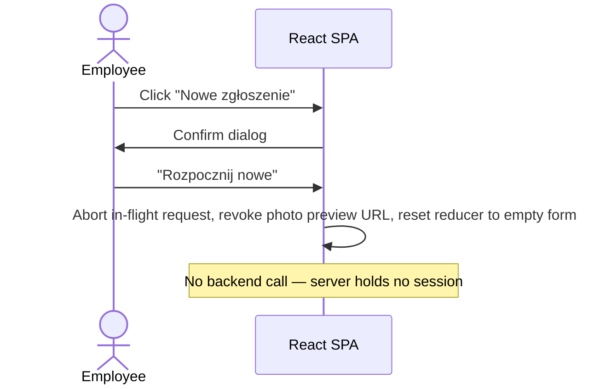

# ADR: Hardware Service Decision Copilot — Main Architecture

**Date:** 2026-10-18
**Status:** Accepted
**PRD:** [`docs/PRD.md`](../PRD.md)

---

## 1. Overview

Hardware Service Decision Copilot is an MVP web application in which a support employee submits a complaint or return case (form + one photo), the system analyses the photo with a multimodal LLM, a reasoning LLM applies the company policy and recommends a decision, and the employee continues in a streamed chat with the agent.

The PRD defines behaviour, UX and acceptance criteria (AC-01…AC-40). This ADR set defines how it is built:

| File | Area |
|---|---|
| `000-main-architecture.md` (this file) | System overview, stack, repository layout, cross-cutting decisions, end-to-end diagrams, overall test strategy |
| [`001-backend-api.md`](001-backend-api.md) | FastAPI service: endpoints, validation, image processing, SSE streaming, errors, configuration |
| [`002-ai-agents.md`](002-ai-agents.md) | Photo-analysis and decision/chat agents: prompts, output models, policy injection, deadline rules, guardrails |
| [`003-frontend.md`](003-frontend.md) | React SPA: screens, state machine, SSE client, validation, styling from design tokens |

---

## 2. Technology Documentation References

All IDs below were resolved with Context7 on 2026-10-18. Implementing agents fetch current docs with `query-docs` using these IDs directly.

| Library | Context7 ID or official docs | Used for |
|---|---|---|
| FastAPI | `/websites/fastapi_tiangolo` | HTTP API, multipart form + file upload, Server-Sent Events (`fastapi.sse`), static file serving |
| Pydantic AI | `/pydantic/pydantic-ai` | Agents, OpenRouter provider, image input (`BinaryContent`), structured output, streaming (`run_stream` / `stream_output`), test models (`TestModel`, `FunctionModel`) |
| Pillow | `/python-pillow/pillow` | Image decoding, format detection, EXIF orientation, resizing, JPEG re-encoding |
| pytest | `/websites/pytest_en_stable` | Backend test runner |
| pytest-asyncio | `/pytest-dev/pytest-asyncio` | Async backend tests |
| pydantic-settings | https://docs.pydantic.dev/latest/concepts/pydantic_settings/ | Environment configuration |
| python-multipart | https://github.com/Kludex/python-multipart | Required by FastAPI for multipart form parsing |
| Uvicorn | https://www.uvicorn.org/ | ASGI server |
| React | `/react/react` (v19.2.x) | UI |
| Vite | `/vitejs/vite` | Frontend dev server (with `/api` proxy) and build |
| Tailwind CSS v4 | `/tailwindlabs/tailwindcss.com` | Styling via `@tailwindcss/vite` and `@theme` tokens |
| react-markdown | `/remarkjs/react-markdown` | Safe Markdown rendering of agent messages (no raw HTML) |
| Vitest | `/vitest-dev/vitest` | Frontend unit/component tests |
| React Testing Library | `/testing-library/react-testing-library` | Component tests |
| Testing Library user-event | `/testing-library/user-event` | Simulated user interaction in component tests |
| Playwright | `/microsoft/playwright` | E2E tests against the real stack; manual QA via `playwright-cli` |
| OpenRouter | https://openrouter.ai/docs | LLM gateway (vision + reasoning models) |

---

## 3. System Architecture

### Architecture pattern

**SPA + stateless REST/SSE API**, single repository, two deployable parts run as two processes in development:

- **Frontend:** React single-page application (Vite). Holds the entire case session state in browser memory.
- **Backend:** FastAPI service. Stateless: every request carries everything needed to process it. Calls OpenRouter for both LLM roles.
- No database in the MVP (PRD §7). The backend keeps nothing between requests.

### Repository structure

```
app/
  backend/                     Python package + tests (own venv: app/backend/.venv)
    pyproject.toml             Project metadata, pytest + ruff config
    requirements.txt           Pinned runtime deps
    requirements-dev.txt       Pinned dev/test deps (includes -r requirements.txt)
    copilot/                   Application package
      main.py                  FastAPI app factory, router registration, static serving
      config.py                Settings from environment
      api/                     HTTP layer (routers, request/response schemas, SSE events)
      domain/                  Pure domain: enums, case model, deadline rules, validation limits
      imaging/                 Image validation + compression
      agents/                  Pydantic AI agents, output models, prompt assembly
      prompts/                 Prompt text files (Markdown)
      policies/                Policy loader (reads docs/policies/*.md)
    tests/
      unit/ integration/ fixtures/
  frontend/                    Vite + React + TypeScript
    package.json
    vite.config.ts             React + Tailwind plugins, /api proxy to backend
    src/
      app/                     App shell, state machine (reducer)
      features/form/           Case form, photo input, validation
      features/processing/     Processing status
      features/chat/           Chat screen, summary panel, messages, input
      lib/                     API client, SSE parser, dates, constants
      i18n/pl.ts               All Polish UI strings
      styles/                  Tailwind entry + @theme tokens
    tests/ (colocated *.test.tsx also allowed)
  e2e/                         Playwright E2E project (TypeScript)
  scripts/dev.sh               Starts backend + frontend together
docs/policies/                 Policy documents (read by backend at startup)
assets/example-images/         Real photos used by E2E and manual QA
```

Build artifacts: `app/frontend/dist/` (served by FastAPI when present). Neither `.venv`, `node_modules`, `dist` nor `.env` is committed.

### Technology stack

| Layer | Technology | Reason |
|---|---|---|
| Backend runtime | Python 3.12+ (dev machine has 3.14), venv + pip | Agreed with the group; no extra tooling to install. |
| Backend framework | FastAPI + Uvicorn | Native multipart upload, Pydantic validation and built-in SSE (`EventSourceResponse`). |
| AI orchestration | Pydantic AI | Typed structured outputs, streaming partial validation, OpenRouter provider, offline test models. |
| LLM access | OpenRouter (one key, two configurable models) | Single gateway; vision and reasoning models chosen independently via env. |
| Image processing | Pillow | Content-based format detection, EXIF transpose, resize, re-encode in memory. |
| Frontend | React 19 + TypeScript + Vite | Group choice; fast dev server with proxy to the API. |
| Styling | Tailwind CSS v4 with `@theme` built from `assets/design-tokens.json` | Brand tokens become utilities; no component library to fight. |
| Markdown | react-markdown (raw HTML disabled) | Safe rendering of agent output (AC-32). |
| Persistence | None (browser memory only) | PRD §7; stateless backend keeps a DB easy to add later. |
| Backend tests | pytest, pytest-asyncio, FastAPI TestClient/httpx | Standard Python testing; Pydantic AI `FunctionModel` replaces the LLM. |
| Frontend tests | Vitest + React Testing Library + user-event (jsdom) | Vite-native, fast component tests. |
| E2E | Playwright Test (TypeScript) | Real browser against the real stack. |

---

## 4. Module Structure & Dependencies

| Module | Responsibility | Depends on | Used by |
|---|---|---|---|
| `copilot.domain` | Enums (case type, category, decision), `CaseInput`, validation limits, deadline rules using Europe/Warsaw "today" | stdlib only | all other backend modules |
| `copilot.config` | Typed settings from env, fail-fast on missing key | pydantic-settings | `main`, `agents`, `policies` |
| `copilot.imaging` | Validate upload (size, real format), EXIF transpose, strip metadata, compress to ≤2048 px / ≤2 MB JPEG | Pillow, `domain` | `api` |
| `copilot.policies` | Load both policy Markdown files once at startup; expose by case type | `config`, `domain` | `agents` |
| `copilot.agents` | Photo-analysis agents, decision agents, chat agents; output models; prompt assembly; deadline guard | Pydantic AI, `domain`, `policies`, `config` | `api` |
| `copilot.api` | Routers, request schemas, SSE event mapping, error mapping, timeouts | FastAPI, `domain`, `imaging`, `agents` | `main` |
| `copilot.main` | App factory, CORS (dev only), static frontend, health | `api`, `config` | Uvicorn |
| `frontend/lib` | API client, SSE parser, date helpers, constants | browser APIs | features |
| `frontend/features/*` | UI per screen | `lib`, `i18n`, `app` state | `app` |
| `frontend/app` | Reducer/state machine, screen switching | `features`, `lib` | `main.tsx` |

Dependency direction (backend): `main → api → (imaging, agents) → (policies, config) → domain`. `domain` imports nothing from the app. No circular imports; `agents` never imports `api`.

Dependency direction (frontend): `app → features → lib/i18n`. `lib` never imports React components.

---

## 5. Data Models

Conceptual models; exact field definitions live in ADR-001 (API) and ADR-002 (agent outputs).

| Model | Purpose | Key fields | Lives in | Lifetime |
|---|---|---|---|---|
| `CaseInput` | Form data | `case_type` (complaint/return), `category` (9 values), `model_name`, `purchase_date`, `description` | Browser state; sent to backend on analyse and every chat turn | Browser tab |
| `Photo` | Uploaded image | original file (browser only), compressed JPEG bytes (backend memory only) | Browser memory (original, preview URL); backend request scope (compressed) | Original: tab. Compressed: one request — never stored, never sent back |
| `PhotoAnalysis` | Structured output of the vision agent | usability, mismatch, damages, signs of use/liquid/impact/tampering, accessories, resellability, Polish summary | Backend → browser (SSE event) → back to backend in every chat request | Browser tab |
| `DeadlineCheck` | Deterministic deadline evaluation | `days_since_purchase`, `limit_days`, `exceeded` | Computed by backend on each request | Request |
| `Decision` | Recommended outcome | `decision` (ACCEPTED / REJECTED / INSPECTION_REQUIRED / ESCALATED), `message_markdown`, `policy_refs[]` | Backend → browser | Browser tab |
| `ChatMessage` | One chat turn | `role` (agent/employee), `content` (Markdown), `decision_change` (optional: from, to, reason) | Browser; full list sent with each chat request | Browser tab |
| `CaseSession` | Everything above for one case | `case`, `analysis`, `initial_decision`, `current_decision`, `messages[]` | Browser reducer state | Until reload or "Nowe zgłoszenie" |

---

## 6. API / Interface Contracts

Summary; full contracts in ADR-001.

| Endpoint | Input | Output | Errors |
|---|---|---|---|
| `GET /api/health` | — | `{status: "ok"}` | — |
| `GET /api/meta` | — | case types, categories (code + Polish label), limits (sizes, lengths, formats), decision labels | — |
| `POST /api/cases/analyze` | `multipart/form-data`: case fields + `photo` | SSE stream: `stage`, `photo_rejected`, `analysis`, `decision_delta`, `decision`, `error`, `done` | `422` JSON with per-field Polish messages; `413` photo > 10 MB; `415` unsupported format; stream `error` event for LLM failures/timeouts |
| `POST /api/cases/chat` | JSON: `case`, `analysis`, `current_decision`, `messages[]`, `new_message` | SSE stream: `delta`, `reply`, `error`, `done` | `422` invalid payload or limits exceeded; stream `error` event |

No authentication (PRD §7). All responses `Cache-Control: no-store`.

---

## 7. Environment Variables

Read from `.env` at the repository root (gitignored); `.env.example` documents them.

| Variable | Purpose | Required | Example value |
|---|---|---|---|
| `OPENROUTER_API_KEY` | OpenRouter API key | Yes | `sk-or-v1-…` |
| `LLM_MODEL` | Default model for both roles when the role-specific vars are unset | Yes (unless both below set) | `openai/gpt-6-luna` |
| `LLM_VISION_MODEL` | Model for photo analysis; must accept image input | No (falls back to `LLM_MODEL`) | `openai/gpt-6-luna` |
| `LLM_DECISION_MODEL` | Reasoning model for decision and chat | No (falls back to `LLM_MODEL`) | `openai/gpt-6-luna` |
| `LLM_TIMEOUT_SECONDS` | Overall limit per analyse / chat request | No (default `90`) | `90` |
| `POLICIES_DIR` | Directory with `return-policy.md` and `complaint-policy.md` | No (default `<repo>/docs/policies`) | `/srv/copilot/policies` |
| `BACKEND_PORT` | Uvicorn port | No (default `8000`) | `8000` |
| `FRONTEND_PORT` | Vite dev server port | No (default `5173`) | `5173` |
| `LOG_LEVEL` | Backend log level | No (default `INFO`) | `INFO` |

The backend refuses to start (clear error message, non-zero exit) when `OPENROUTER_API_KEY` is missing, no model is configured, or a policy file is missing/empty.

---

## 8. Technical Decisions

### D1 — Python FastAPI backend + React SPA
**Status:** Accepted
**Date:** 2026-10-18
**Context:** The group wanted a Python backend for AI work and a modern web UI; the repository is a greenfield scaffold.
**Decision:** FastAPI backend in `app/backend`, Vite + React + TypeScript SPA in `app/frontend`, two processes in development with a Vite proxy for `/api`; in production mode FastAPI serves `app/frontend/dist`.
**Rejected alternatives:**
- Next.js + Vercel AI SDK: single TypeScript codebase, but the group chose Python for the AI layer.
- Server-rendered templates (Jinja/HTMX): weaker fit for a streaming chat UI and component tests.
**Consequences:**
- (+) Clear split; Python AI ecosystem; fast HMR in the frontend.
- (-) Two toolchains (pip + npm); validation limits must be kept consistent (mitigated by `GET /api/meta`).
**Review trigger:** If the app needs SSR/SEO or is deployed as a single serverless function.

### D2 — Stateless backend, case session held in the browser
**Status:** Accepted
**Date:** 2026-10-18
**Context:** PRD requires no persistence and a session that ends with the tab (AC-37); the chat needs full context on every turn.
**Decision:** The browser keeps `CaseSession` in memory and sends `case`, `analysis`, `current_decision` and all `messages` with every chat request. The photo itself is analysed once and never resent; later turns rely on `PhotoAnalysis`.
**Rejected alternatives:**
- Server-side in-memory sessions: lost on restart, needs eviction and session IDs, breaks with multiple workers.
- SQLite now: out of MVP scope (PRD §7).
**Consequences:**
- (+) No server state, trivially restartable, horizontal scaling not blocked; DB can be added later behind the same contract.
- (-) Payload grows with the conversation (bounded by limits in ADR-001: max 40 messages).
- (-) The client could tamper with `analysis`/`current_decision`. Accepted for an internal MVP tool without auth; deadlines are always recomputed server-side (D5).
**Review trigger:** When session logging (PRD deferred feature) or auth is added — move session state to the server and sign or store it.

### D3 — Pydantic AI over OpenRouter, two configurable models
**Status:** Accepted
**Date:** 2026-10-18
**Context:** Photo analysis needs a vision model; decisions need a reasoning model; the repo already standardises on `OPENROUTER_API_KEY`.
**Decision:** Pydantic AI agents with the OpenRouter provider. `LLM_VISION_MODEL` and `LLM_DECISION_MODEL` select models independently, both defaulting to `LLM_MODEL`.
**Rejected alternatives:**
- Raw OpenAI SDK against OpenRouter: manual JSON-schema output, partial streaming parsing and retries.
- LangChain: heavier abstraction than needed for two linear agent calls.
**Consequences:**
- (+) Typed outputs with validation and retries; streaming partial structured output; `FunctionModel` for offline tests.
- (-) Dependent on the model supporting structured output/tool calling via OpenRouter; verified per chosen model during implementation.
**Review trigger:** If a chosen model cannot produce structured output reliably (>5% validation failures in manual QA), or OpenRouter is replaced.

### D4 — Server-Sent Events over POST for analysis and chat
**Status:** Accepted
**Date:** 2026-10-18
**Context:** The UI must show processing stages (AC-24) and stream agent text; requests carry a file or a large JSON body.
**Decision:** Both `POST /api/cases/analyze` and `POST /api/cases/chat` respond with `text/event-stream` using FastAPI's `EventSourceResponse`. The frontend reads the stream with `fetch` + `ReadableStream` and a small SSE parser (browser `EventSource` does not support POST bodies).
**Rejected alternatives:**
- WebSockets: bidirectional channel not needed; harder to proxy and test.
- Polling a job ID: needs server-side job state (contradicts D2).
- Non-streamed JSON: no stage feedback, long blank waits.
**Consequences:**
- (+) One request per action; stages and tokens arrive in order; errors after headers are sent are delivered as `error` events.
- (-) Custom client parser to maintain (unit-tested).
**Review trigger:** If the UI needs server-initiated messages outside a request (e.g., notifications).

### D5 — Deterministic deadline rules enforced in code
**Status:** Accepted
**Date:** 2026-10-18
**Context:** AC-19/AC-20 must hold every time; LLMs make date arithmetic errors.
**Decision:** The backend computes `days_since_purchase` in Europe/Warsaw and whether the policy limit is exceeded (return: >14 days; complaint: >730 days, i.e. purchase date earlier than the same calendar date two years ago). The result is given to the agent as a fact, and an output validator rejects any decision other than REJECTED when the limit is exceeded (agent is asked to retry; after retries the request fails with an error).
**Rejected alternatives:**
- Let the LLM compute deadlines: non-deterministic, untestable.
- Short-circuit without calling the LLM: loses the agent's Polish explanation and next steps.
**Consequences:**
- (+) AC-19/AC-20 testable with unit tests; agent explanations stay natural.
- (-) Rules duplicated between policy text and code; a policy change requires a code change (documented in ADR-002).
**Review trigger:** When policies become editable by non-developers or more time-based rules are added.

### D6 — Image compression in the backend, nothing stored
**Status:** Accepted
**Date:** 2026-10-18
**Context:** PRD AC-13 requires ≤2048 px and ≤2 MB before analysis; photos may contain personal data (PRD §8).
**Decision:** The backend decodes the upload with Pillow (format detected from content, not the extension or MIME), applies EXIF orientation, strips all metadata, converts to RGB, scales to max 2048 px on the longer side and re-encodes JPEG, lowering quality and then size until ≤2 MB. Processing is in memory; bytes are discarded at the end of the request.
**Rejected alternatives:**
- Client-side compression: cannot be trusted and duplicates logic.
- Sending originals: exceeds model limits and costs; leaks EXIF (e.g., GPS).
**Consequences:**
- (+) Single, testable place for limits; metadata never reaches the LLM.
- (-) CPU work per request (acceptable for MVP volume).
**Review trigger:** If uploads >10 MB or multiple photos per case are introduced.

### D7 — Policies as Markdown files loaded at startup
**Status:** Accepted
**Date:** 2026-10-18
**Context:** PRD §8 lists the two policy documents; no admin UI.
**Decision:** The backend reads `return-policy.md` and `complaint-policy.md` from `POLICIES_DIR` once at startup and injects the full text of the relevant one into the decision and chat agent instructions.
**Rejected alternatives:**
- RAG over policies: documents are short; RAG is a deferred feature.
- Hard-coding policy text in prompts: duplicates the documents.
**Consequences:**
- (+) Editing a policy = editing a file + restart.
- (-) Prompt size grows with policy length (both are under ~1,500 words).
**Review trigger:** When policies exceed ~10,000 tokens or a knowledge base is added.

### D8 — Disclaimer appended by the backend
**Status:** Accepted
**Date:** 2026-10-18
**Context:** PRD §11.4 requires an exact disclaimer at the end of the first decision and every revision.
**Decision:** The agent is instructed not to write the disclaimer; the backend appends the exact disclaimer text to the final `message_markdown` of the initial decision and of every chat reply with a decision change, before sending the final event.
**Rejected alternatives:**
- Rely on the prompt: wording drifts.
- Frontend appends it: the text would be missing from the history sent back to the agent.
**Consequences:**
- (+) Exact text, testable.
- (-) It appears only in the final event, not during streaming deltas (frontend replaces the streamed text with the final text).
**Review trigger:** If legal wording becomes configurable.

---

## 9. Diagrams

### 9.1 Architecture / Component Diagram



### 9.2 Data Flow Diagram



### 9.3 Sequence Diagrams

#### Form submission, photo analysis and initial decision (happy path)



#### Unusable photo



#### LLM failure or timeout during analysis



#### Chat turn (streamed, optional decision change)

```mermaid
sequenceDiagram
    actor E as Employee
    participant UI as React SPA
    participant API as FastAPI
    participant CA as Chat agent
    participant OR as OpenRouter
    E->>UI: Type message, Enter
    UI->>UI: Append employee message, show "pisze…"
    UI->>API: POST /api/cases/chat {case, analysis, current_decision, messages, new_message}
    API->>API: Validate limits, recompute DeadlineCheck
    API->>CA: reply(history, new_message)
    CA->>OR: reasoning model request (stream)
    loop partial output
        OR-->>CA: tokens
        API-->>UI: event delta {message_markdown}
    end
    CA-->>API: ChatReply {message, decision_change?}
    API->>API: deadline guard; append disclaimer if decision changed
    API-->>UI: event reply {ChatReply}
    API-->>UI: event done
    UI->>UI: Replace streamed text with final; update summary panel if changed (AC-30)
```

#### New case



---

## 10. Testing Strategy

### Philosophy

TDD per `AGENTS.md`: for every unit of behaviour write the failing test first from the PRD/ADR, confirm it fails for the expected reason, implement the minimum, then refactor green. Tests are the implementing agent's primary self-check; manual QA with `playwright-cli` on the running app closes every UI task.

Mocks follow the repository rule: **unit** — all dependencies mocked; **integration** — only the external LLM is replaced (Pydantic AI `FunctionModel`), everything else real (FastAPI app, Pillow, policy files, SSE); **E2E** — nothing mocked (real OpenRouter). LLM fakes are derived from **captured real responses**: before writing an integration fake, run the real agent once against OpenRouter with an example image and save the full structured output verbatim with date, model ID and request description in `app/backend/tests/fixtures/captures/` (no secrets).

### Test layers

| Layer | Type | Scope | Tools |
|---|---|---|---|
| Backend unit | Unit | domain rules, deadline calc, imaging, prompt assembly, output validators, SSE event mapping, settings | pytest, pytest-asyncio, `TestModel`/`FunctionModel` |
| Backend integration | Integration | Real app via TestClient: `/api/meta`, `/api/cases/analyze`, `/api/cases/chat` with real Pillow and policy files; LLM = `FunctionModel` replaying captures | pytest, FastAPI TestClient / httpx |
| Frontend unit/component | Unit | reducer, SSE parser, validation, components with mocked `fetch` | Vitest, React Testing Library, user-event, jsdom |
| E2E | E2E | Full stack, real OpenRouter, real photos from `assets/example-images/` | Playwright Test |
| Manual QA | Manual | Each touched screen; screenshots compared with `assets/homepage.png` + `docs/design-guidelines.md` | `playwright-cli` |

### Key test scenarios

| Scenario | What is tested | Input | Expected | Edge cases |
|---|---|---|---|---|
| Complaint happy path | Full analyse flow | Complaint, Smartfon, `phone-1.jpg`, description ≥10 chars | Events: stage(photo) → analysis → stage(decision) → decision_delta… → decision → done; decision has one of 4 values, ≥1 policy ref, ends with disclaimer | Model returns refs in other format |
| Return deadline exceeded | AC-19 | Return, purchase 15 days ago | Decision REJECTED regardless of fake model trying ACCEPTED (validator forces retry) | Exactly 14 days → not exceeded; DST boundary |
| Complaint deadline exceeded | AC-20 | Purchase 2 years + 1 day ago | REJECTED | 29 Feb purchase date |
| Unusable photo | AC-16 | Fake analysis `is_usable=false` | `photo_rejected` event, decision agent not called | Category mismatch reason |
| Format by content | D6 | `laptop-1.png` (JPEG content, .png name) | Accepted, processed as JPEG | — |
| Unsupported format | AC-08 | Plain text file named `.jpg` | 415 with Polish message | Empty file |
| Oversize | AC-09 | 10 MB + 1 byte payload | 413 before decoding | Exactly 10 MB accepted |
| Compression | AC-13 | `laptop-1.png` (3024×3135) | Output ≤2048 px longer side, ≤2 MB, JPEG, no EXIF | Small image (`phone-2.jpeg`) not upscaled |
| Validation | AC-04…AC-06 | Missing description for complaint; future date; 1-char model | 422 with field → Polish message | Whitespace-only fields |
| LLM failure | AC-34 | `FunctionModel` raises | `error` event `llm_unavailable` | Timeout via tiny `LLM_TIMEOUT_SECONDS` |
| Chat context | AC-29 | History with charger message | Request to model contains case, analysis, policy, all messages in order | 40-message limit → 422 |
| Decision revision | AC-30/31 | Fake reply with `decision_change` | `reply` has change + disclaimer; without change no disclaimer | Change to ACCEPTED when deadline exceeded → rejected by guard |
| New case | AC-36 | UI click + confirm | Empty form, no previous data in next request | Click during streaming aborts request |

### Technical acceptance criteria

- **TAC-01** `pytest` in `app/backend` passes with zero failures and zero unexpected skips; no test performs a real network call (Pydantic AI `ALLOW_MODEL_REQUESTS` is disabled in the test session).
- **TAC-02** `npm test` in `app/frontend` passes; `npm run build` and `npm run lint` finish with no errors or warnings; `tsc --noEmit` reports no errors.
- **TAC-03** `ruff check` and `ruff format --check` pass in `app/backend`.
- **TAC-04** Playwright E2E suite passes against the real stack with a valid `OPENROUTER_API_KEY`; E2E is not part of the default unit test command.
- **TAC-05** The backend exits with a non-zero code and a clear message when `OPENROUTER_API_KEY` or a policy file is missing.
- **TAC-06** No uploaded image or compressed image is written to disk by the backend (verified by integration test using a temporary working directory listing before/after).
- **TAC-07** Backend logs never contain the photo bytes, the case description, or chat message text (verified by a log-capture test).
- **TAC-08** `scripts/dev.sh` starts both processes; `http://localhost:5173` shows the form and `GET /api/health` via the proxy returns `{status: "ok"}`.
