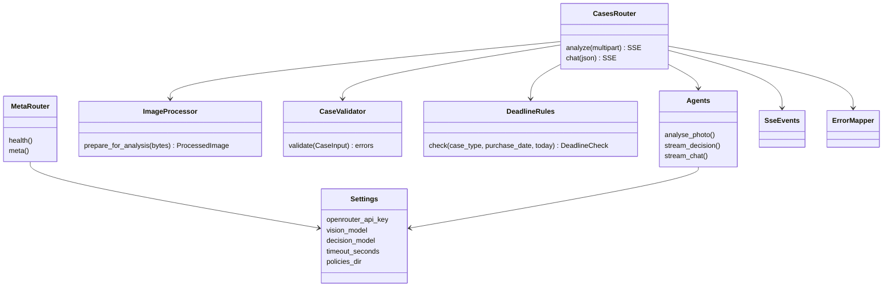
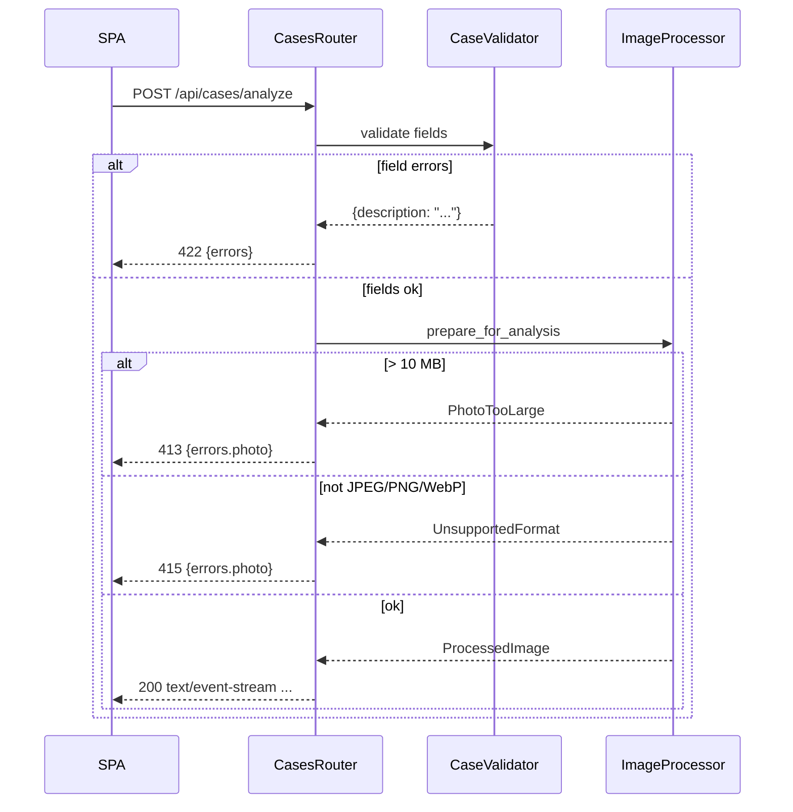
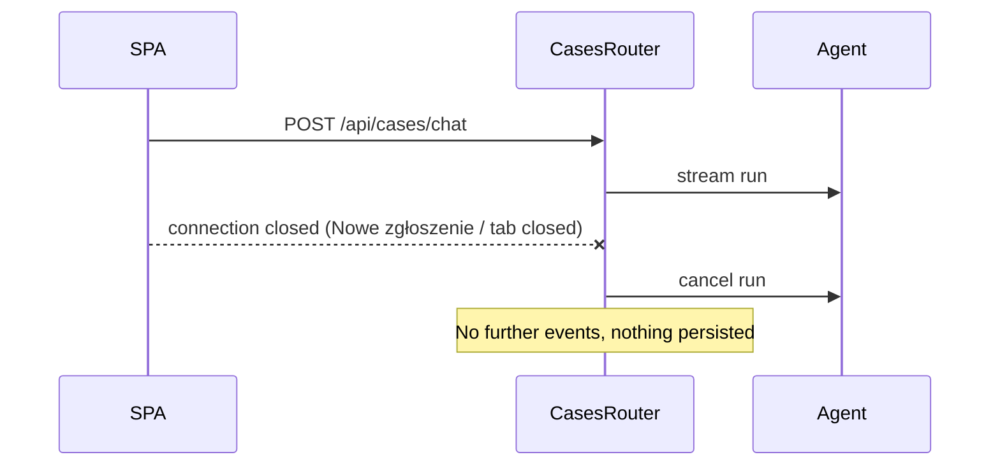

# ADR-001: Backend API

**Date:** 2026-10-18
**Status:** Accepted
**Relates to:** `docs/ADR/000-main-architecture.md`

---

## 1. Scope

Covers the FastAPI service in `app/backend`: configuration, HTTP endpoints, request validation, image validation and compression, SSE event protocol, timeouts, error mapping, logging, static serving and local run commands.

Not covered: agent prompts, output models and deadline guard internals (ADR-002); frontend (ADR-003).

---

## 2. Technology Documentation References

| Library | Context7 ID or official docs | Used for |
|---|---|---|
| FastAPI | `/websites/fastapi_tiangolo` | Routers, `Form`/`File`/`UploadFile`, `EventSourceResponse` + `ServerSentEvent` (`fastapi.sse`), `StaticFiles`, `TestClient` |
| Pillow | `/python-pillow/pillow` | `Image.open` + `verify`, `ImageOps.exif_transpose`, `thumbnail`, JPEG `save(quality=…, optimize=True)` |
| pydantic-settings | https://docs.pydantic.dev/latest/concepts/pydantic_settings/ | `BaseSettings` reading `.env` |
| python-multipart | https://github.com/Kludex/python-multipart | Multipart parsing dependency of FastAPI |
| Uvicorn | https://www.uvicorn.org/ | ASGI server, `--reload` in dev |
| pytest / pytest-asyncio | `/websites/pytest_en_stable`, `/pytest-dev/pytest-asyncio` | Tests |
| Ruff | https://docs.astral.sh/ruff/ | Lint + format |

Use a FastAPI version that ships `fastapi.sse` (verify with Context7 before pinning). Pin exact versions in `requirements*.txt`.

---

## 3. Component Design

| Component | Responsibility |
|---|---|
| `config.Settings` | Loads env vars (ADR-000 §7) from the repo-root `.env`; validates presence of key and model; resolves `POLICIES_DIR`; exposes `timeout_seconds`. Built once at startup. |
| `domain.enums` | `CaseType` {`complaint`, `return`}; `Category` {`smartphone`, `laptop`, `tablet`, `tv`, `audio`, `console`, `smartwatch`, `small_appliance`, `other`} with Polish labels (Smartfon, Laptop, Tablet, Telewizor, Słuchawki / audio, Konsola do gier, Smartwatch, Małe AGD, Inne); `DecisionCode` {`ACCEPTED`, `REJECTED`, `INSPECTION_REQUIRED`, `ESCALATED`} with Polish labels (Przyjęte, Odrzucone, Wymaga inspekcji serwisu, Przekazane do specjalisty). |
| `domain.limits` | Single source of limits: model name 2–100, description complaint 10–2000 / return 0–2000, photo ≤10 MB (10 × 1024 × 1024 bytes), accepted formats JPEG/PNG/WebP, analysis image ≤2048 px and ≤2 MB (2 × 1024 × 1024 bytes), chat message 1–2000, agent message ≤8000, max 40 messages per case. |
| `domain.clock` | `today_warsaw()` — current date in `Europe/Warsaw`; injectable for tests. |
| `domain.case` | `CaseInput` validation (trimming, lengths, date not in future, description rule per case type) returning field-keyed Polish messages. |
| `imaging.processor` | `prepare_for_analysis(bytes) → ProcessedImage` (see §3.1). Raises typed errors: `PhotoTooLarge`, `UnsupportedFormat`, `CorruptImage`. |
| `api.meta` | `GET /api/meta`, `GET /api/health`. |
| `api.cases` | `POST /api/cases/analyze`, `POST /api/cases/chat`; orchestrates imaging + agents; maps results to SSE events. |
| `api.sse` | Builders for each event type (§4.3) — keeps event names and payload shapes in one place. |
| `api.errors` | Exception → HTTP status / SSE `error` event mapping with Polish messages; never exposes internals (AC-39). |
| `main.create_app()` | Builds the app, registers routers under `/api`, adds `Cache-Control: no-store` to `/api/*`, enables CORS only for `http://localhost:${FRONTEND_PORT}` when the frontend build is absent (dev), mounts `app/frontend/dist` at `/` with SPA fallback when present. |

### 3.1 Image processing pipeline

1. Reject if byte length > 10 MB → `PhotoTooLarge` (checked while reading, before decoding; the upload is read in chunks and aborted at the limit).
2. Open with Pillow from memory and `verify()`; reopen. Detect the real format from content. Allow only `JPEG`, `PNG`, `WEBP` → else `UnsupportedFormat`. Decoding errors → `CorruptImage` (reported as unsupported format to the user). The file name extension and the client MIME type are ignored.
3. Guard against decompression bombs (keep Pillow's default `MAX_IMAGE_PIXELS` protection; treat its warning/error as `CorruptImage`).
4. `ImageOps.exif_transpose`; convert to RGB (alpha composited on white).
5. If the longer side > 2048 px, downscale with `thumbnail((2048, 2048))` (never upscale).
6. Encode JPEG with `optimize=True` and no metadata (no EXIF, no ICC). Try quality 85, 75, 65, 55; if still > 2 MB, scale dimensions by 0.8 and repeat from 85; stop when ≤ 2 MB.
7. Return `ProcessedImage {bytes, media_type: "image/jpeg", width, height, original_format}`. All in memory.

### 3.2 Request orchestration — analyse

1. Parse multipart fields; run `CaseInput` validation → on errors return **422** JSON (before any streaming).
2. Run imaging → on `PhotoTooLarge` **413**, on `UnsupportedFormat`/`CorruptImage` **415** (JSON, before streaming).
3. Start SSE response. Wrap the remaining steps in one overall timeout of `LLM_TIMEOUT_SECONDS` (default 90 s).
4. Emit `stage {stage: "photo_analysis"}` → run vision agent (ADR-002) → emit `analysis`.
5. If `analysis.is_usable` is false → emit `photo_rejected` + `done`; stop.
6. Emit `stage {stage: "decision"}` → compute `DeadlineCheck` → stream decision agent; for each partial output emit `decision_delta`; after the final validated output append the disclaimer (ADR-000 D8) and emit `decision` → `done`.
7. Any agent exception or timeout → emit `error` + `done`. If the client disconnects, cancel the agent run.

### 3.3 Request orchestration — chat

1. Validate JSON body (§4.2) → **422** on failure.
2. Recompute `DeadlineCheck` from `case.purchase_date` (never trust client-side values).
3. Start SSE; same overall timeout. Stream chat agent; emit `delta` with accumulated text; on completion run the deadline guard and disclaimer rule; emit `reply` → `done`. Errors → `error` + `done`.

---

## 4. Data Structures

### 4.1 Analyse request (`multipart/form-data`)

| Field | Type | Constraints |
|---|---|---|
| `case_type` | string | `complaint` \| `return` |
| `category` | string | one of the 9 `Category` codes |
| `model_name` | string | trimmed length 2–100 |
| `purchase_date` | string | ISO date `YYYY-MM-DD`, ≤ today (Europe/Warsaw) |
| `description` | string | trimmed; complaint 10–2000; return 0–2000 (may be omitted) |
| `photo` | file | required; ≤10 MB; content JPEG/PNG/WebP |

### 4.2 Chat request (`application/json`)

| Field | Type | Constraints |
|---|---|---|
| `case` | object | same fields and rules as 4.1 except `photo` |
| `analysis` | `PhotoAnalysis` (ADR-002) | must validate against the model; `is_usable` must be true |
| `current_decision` | `DecisionCode` | required |
| `messages` | array of `{role: "agent" \| "employee", content: string}` | 1–40 items; first item role `agent` (the initial decision); employee content 1–2000, agent content 1–8000 |
| `new_message` | string | trimmed length 1–2000 |

### 4.3 SSE events

Each event has an `event` name and JSON `data`.

| Event | Endpoint | Data | Notes |
|---|---|---|---|
| `stage` | analyze | `{stage: "photo_analysis" \| "decision"}` | Drives AC-24 progress UI |
| `analysis` | analyze | `PhotoAnalysis` | Stored by client for chat |
| `photo_rejected` | analyze | `{reason_code, message}` | `reason_code` ∈ `not_equipment`, `category_mismatch`, `blurry`, `too_dark`, `too_small`, `other`; `message` Polish (from a fixed map, ADR-002 §4.3) |
| `decision_delta` | analyze | `{decision: DecisionCode \| null, message_markdown: string}` | Accumulated partial text (not a diff) |
| `decision` | analyze | `Decision {decision, message_markdown, policy_refs[]}` | Final; includes disclaimer |
| `delta` | chat | `{message_markdown: string}` | Accumulated partial text |
| `reply` | chat | `ChatReply {message_markdown, decision_change: null \| {from, to, reason}}` | Final; disclaimer included when `decision_change` not null |
| `error` | both | `{code, message}` | `code` ∈ `llm_unavailable`, `timeout`, `invalid_model_output`, `internal`; `message` Polish |
| `done` | both | `{}` | Always the last event |

### 4.4 Error responses (non-stream)

| Status | Body | When |
|---|---|---|
| 422 | `{errors: {<field>: <Polish message>}}` | Field validation (messages exactly as in PRD AC-04…AC-09 where defined) |
| 413 | `{errors: {photo: "Plik przekracza limit 10 MB."}}` | Photo > 10 MB |
| 415 | `{errors: {photo: "Nieobsługiwany format pliku. Dozwolone: JPG, PNG, WebP."}}` | Not JPEG/PNG/WebP by content, or undecodable |
| 500 | `{errors: {_: "Wystąpił nieoczekiwany błąd. Spróbuj ponownie."}}` | Unhandled exception before streaming |

Polish messages for `error` events: `llm_unavailable` / `timeout` / `invalid_model_output` / `internal` on analyse → "Nie udało się przeanalizować zgłoszenia. Spróbuj ponownie za chwilę." (AC-34); on chat → "Nie udało się wysłać wiadomości." (AC-35).

---

## 5. Interface Contracts

| Endpoint | Method | Input | Output | Errors |
|---|---|---|---|---|
| `/api/health` | GET | — | `200 {status: "ok"}` | — |
| `/api/meta` | GET | — | `200 {case_types:[{code,label}], categories:[{code,label}], decisions:[{code,label}], limits:{…§3 domain.limits}, accepted_formats:["image/jpeg","image/png","image/webp"]}` | — |
| `/api/cases/analyze` | POST | §4.1 | `200 text/event-stream` §4.3 | 422, 413, 415, 500; stream `error` |
| `/api/cases/chat` | POST | §4.2 | `200 text/event-stream` §4.3 | 422, 500; stream `error` |

All `/api/*` responses carry `Cache-Control: no-store`. Request body for analyse is capped at 11 MB overall.

### Local commands (from `app/backend`)

- Create env: `python3 -m venv .venv`, then `.venv/bin/pip install -r requirements-dev.txt`.
- Run: `.venv/bin/uvicorn copilot.main:app --reload --port 8000` (the app factory reads `.env` from the repo root).
- Test: `.venv/bin/pytest`; lint: `.venv/bin/ruff check . && .venv/bin/ruff format --check .`.
- `app/scripts/dev.sh` starts Uvicorn and the Vite dev server together and stops both on Ctrl+C.

### Logging

One structured line per request: request ID, endpoint, case type, category, original image format and size, processed size, model IDs, stage durations, resulting decision code or error code. Never logged: image bytes, `model_name`, `description`, chat text, API key.

---

## 6. Technical Decisions

### B1 — Validate and compress before opening the stream
**Status:** Accepted
**Date:** 2026-10-18
**Context:** Field and file errors must map to specific form fields; once SSE headers are sent the status code is fixed at 200.
**Decision:** All synchronous validation (fields, size, format, decoding, compression) runs before the `EventSourceResponse` starts, returning 422/413/415 JSON. Only LLM work happens inside the stream.
**Rejected alternatives:**
- Everything inside the stream with `error` events: frontend would need a second error path for field errors.
**Consequences:**
- (+) Field errors use one well-defined JSON shape.
- (-) Compression latency (<1 s for 10 MB) happens before the first `stage` event.
**Review trigger:** If compression becomes slow enough to need its own progress stage.

### B2 — Accumulated text in delta events
**Status:** Accepted
**Date:** 2026-10-18
**Context:** Pydantic AI `stream_output()` yields partially validated snapshots, not token diffs.
**Decision:** `decision_delta` and `delta` carry the full text so far; the client replaces, not appends.
**Rejected alternatives:**
- Compute diffs server-side: extra logic, fragile with re-validated partials.
**Consequences:**
- (+) Idempotent client rendering; a lost event cannot corrupt text.
- (-) More bytes on the wire (≤8 KB per event; acceptable). Debounce partials at 100 ms (library default).
**Review trigger:** If messages exceed ~20 KB.

### B3 — Limits served by `/api/meta`
**Status:** Accepted
**Date:** 2026-10-18
**Context:** Frontend and backend must apply identical limits and labels.
**Decision:** `domain.limits` and `domain.enums` are the source of truth; the frontend fetches `/api/meta` on load and uses it for validation and dropdowns. The frontend also ships identical defaults so a failed `/api/meta` call doesn't block the form (a test asserts the defaults equal the `/api/meta` response).
**Rejected alternatives:**
- Hard-code in both places without a check: values drift.
- Generate TS types from OpenAPI: extra build step not justified for the MVP.
**Consequences:**
- (+) One place to change limits.
- (-) One extra request on page load.
**Review trigger:** If the API surface grows beyond ~5 endpoints (then generate a typed client).

---

## 7. Diagrams

### Component Diagram

### Sequence — validation failure (no stream)

### Sequence — client disconnect

---

## 8. Testing Strategy

### Test scenarios for this area

| Scenario | Type | Input | Expected output | Edge cases |
|---|---|---|---|---|
| Settings fail fast | Unit | No `OPENROUTER_API_KEY` | Startup error naming the variable | Only `LLM_MODEL` set → both roles use it |
| Case validation | Unit | Each field at/over limits | Field-keyed Polish messages | Whitespace trimming; return without description OK; complaint with 9 chars fails |
| Future date | Unit | Tomorrow (Warsaw) | `purchase_date` error "Data zakupu nie może być z przyszłości." | 23:30 UTC on the day before = already "today" in Warsaw |
| Format by content | Unit | `assets/example-images/laptop-1.png` | Accepted as JPEG | `laptop-2.webp` accepted |
| Unsupported format | Unit | Text bytes named `photo.jpg` | `UnsupportedFormat` | Truncated JPEG → `CorruptImage` |
| Size limit | Unit | 10 MB + 1 byte payload | `PhotoTooLarge` without decoding | Exactly 10 MB of a non-image → passes size, fails format |
| Downscale | Unit | `laptop-1.png` (3024×3135) | Longer side 2048, ≤2 MB, JPEG, no EXIF/ICC | `phone-2.jpeg` (387×516) keeps size |
| SSE builders | Unit | Each event | Correct `event` name + JSON | Polish characters UTF-8 |
| Analyse happy path | Integration | Real app, real image, `FunctionModel` replaying captured analysis + decision | Ordered events stage→analysis→stage→decision_delta+→decision→done; disclaimer at end | Partial with `decision: null` first |
| Photo rejected | Integration | Captured unusable analysis | `photo_rejected` then `done`; decision model never called | — |
| 422/413/415 | Integration | Bad fields / big file / text file | Status + `errors` shape §4.4 | Missing `photo` field → 422 |
| LLM error | Integration | `FunctionModel` raising | `error {code: llm_unavailable}` + `done` | Timeout with `LLM_TIMEOUT_SECONDS=0.1` → `timeout` |
| Chat limits | Integration | 41 messages; 2001-char message | 422 | First message not from agent → 422 |
| Chat deadline recomputed | Integration | Return 20 days old, client sends `current_decision=ACCEPTED`, fake reply changes to ACCEPTED | Guard forces REJECTED; no change event to ACCEPTED | — |
| No disk writes | Integration | Analyse in temp CWD | No new files | — |
| No sensitive logs | Integration | Capture logs during analyse/chat | No description/chat text/image bytes | — |
| Meta | Integration | `GET /api/meta` | 9 categories, 4 decisions, limits match `domain.limits` | — |
| Static serving | Integration | `dist/index.html` present | `/` and unknown non-API paths return index | `/api/unknown` → 404 JSON |

### Technical acceptance criteria

- **TAC-001-01** Every analyse/chat stream ends with exactly one `done` event, and no event follows it.
- **TAC-001-02** An analyse stream contains either (`analysis` and `photo_rejected`) or (`analysis` and `decision`) or `error` — never both `photo_rejected` and `decision`.
- **TAC-001-03** For `assets/example-images/laptop-1.png` the image sent to the vision agent is JPEG, longer side exactly 2048 px, ≤ 2,097,152 bytes, and has no EXIF data.
- **TAC-001-04** A 10,485,761-byte upload returns 413 within 1 second without invoking Pillow decoding.
- **TAC-001-05** With `LLM_TIMEOUT_SECONDS=0.1` and a fake model that sleeps 1 s, the stream emits `error {code: "timeout"}` then `done`.
- **TAC-001-06** All `/api/*` responses include `Cache-Control: no-store`.
