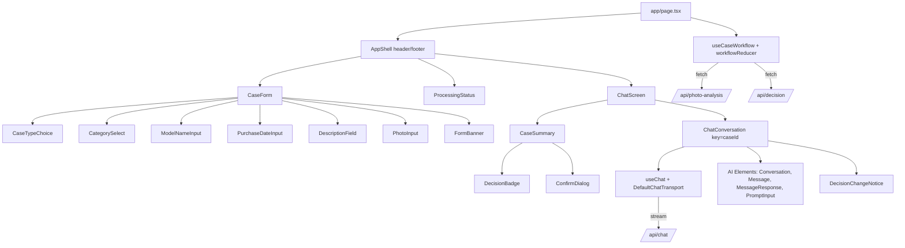
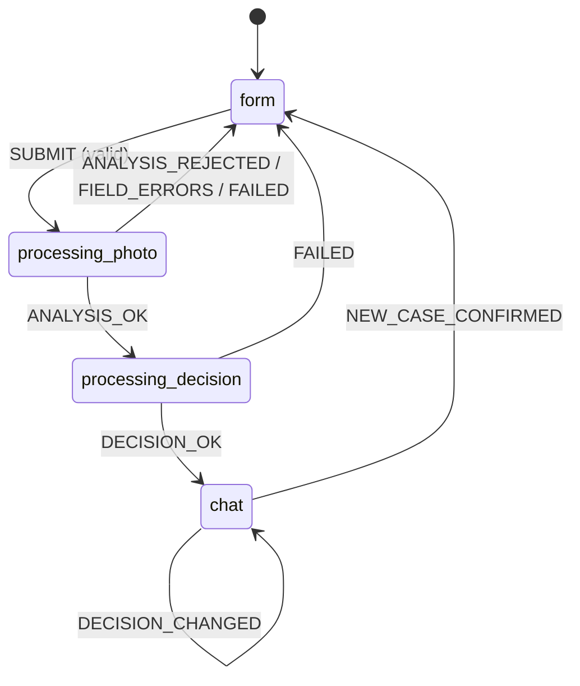
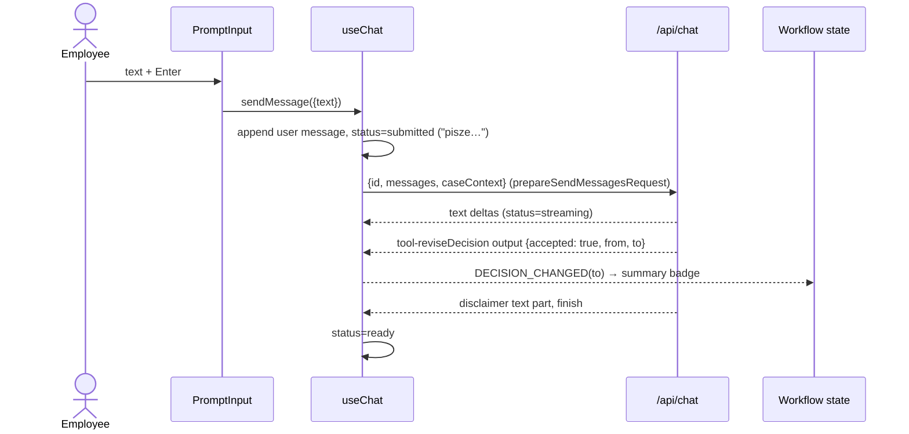

# ADR-003: Frontend and Chat UI

**Date:** 2026-10-18
**Status:** Accepted
**Relates to:** `docs/ADR/000-main-architecture.md`

---

## 1. Scope

Client side: the single page and its three screens (form, processing, chat), the workflow state machine, how the form → photo analysis → decision → chat flow maps to components and endpoints, `useChat` configuration (seeding, custom body, abort, errors), AI Elements usage, Markdown safety, styling from brand tokens, accessibility and frontend tests. Not covered: server logic (ADR-002), project setup (ADR-001).

---

## 2. Technology Documentation References

| Library | Context7 ID or official docs | Used for |
|---|---|---|
| AI SDK React | `/vercel/ai` (`@ai-sdk/react`) | `useChat({id, messages, transport, onError, onFinish})`, `DefaultChatTransport({api, prepareSendMessagesRequest})`, `sendMessage`, `setMessages`, `stop`, `status`, typed `UIMessage` parts |
| AI Elements | `/vercel/ai-elements` | `Conversation` / `ConversationContent` / `ConversationScrollButton`, `Message` / `MessageContent` / `MessageResponse`, `PromptInput` / `PromptInputTextarea` / `PromptInputSubmit` |
| shadcn/ui | `/shadcn-ui/ui` | `Button`, `Dialog` (confirm), `Select`, `RadioGroup`, `Textarea`, `Input`, `Badge`, `Collapsible` |
| Next.js | `/vercel/next.js` | App Router page, client components, `next/font` not used (system stacks) |
| Tailwind CSS v4 | `/tailwindlabs/tailwindcss.com` | `@theme` tokens |
| Vitest / RTL / user-event | `/vitest-dev/vitest`, `/testing-library/react-testing-library`, `/testing-library/user-event` | Tests |
| Playwright | `/microsoft/playwright` | E2E with `setInputFiles` and example images |

---

## 3. Component Design

### 3.1 Flow → endpoints → components

| PRD step | Client component(s) | State | Endpoint | Notes |
|---|---|---|---|---|
| 1–3 Form + client validation | `CaseForm` (`CaseTypeChoice`, `CategorySelect`, `ModelNameInput`, `PurchaseDateInput`, `DescriptionField`, `PhotoInput`, `FormBanner`) | `form` | — | zod `caseInputSchema` from `lib/domain` (same as server) |
| 4–5 "Analiza zdjęcia" | `ProcessingStatus` (stage 1 active) | `processing:photo` | `POST /api/photo-analysis` (FormData) | 422/413/415 → field errors; `rejection` → form with photo cleared |
| 6–7 "Przygotowanie decyzji" | `ProcessingStatus` (stage 2 active) | `processing:decision` | `POST /api/decision` (JSON) | 502/504 → form banner + retry |
| 8 First message | `ChatScreen` → `CaseSummary` + `ChatConversation` | `chat` | — | `useChat` seeded with the decision message |
| 9 Follow-ups | `ChatConversation` (`PromptInput`) | `chat` | `POST /api/chat` via `useChat` | Streaming |
| New case | `CaseSummary` → `ConfirmDialog` | → `form` | — | Abort + reset |

### 3.2 Workflow state machine (`features/workflow/`)

`workflowReducer` (pure, unit-tested) + `useCaseWorkflow` hook (effects).

| State | Data | Transitions |
|---|---|---|
| `form` | `draft` (fields + photo `File` + preview URL), `fieldErrors`, `banner` (`serviceError` \| `photoRejected` \| null) | `SUBMIT` → `processing:photo` |
| `processing:photo` | `draft` | `ANALYSIS_OK` → `processing:decision`; `ANALYSIS_REJECTED` → `form` (photo cleared, banner); `FIELD_ERRORS` → `form`; `FAILED` → `form` (all kept, banner + retry) |
| `processing:decision` | `draft`, `analysis` | `DECISION_OK` → `chat`; `FAILED` → `form` (all kept) |
| `chat` | `case`, `photoPreviewUrl`, `analysis`, `initialDecision`, `currentDecision` | `DECISION_CHANGED` (from tool part); `NEW_CASE_CONFIRMED` → `form` (empty) |

The hook runs both requests with one `AbortController` and a 90 s total timer (AC-34). "Spróbuj ponownie" re-dispatches `SUBMIT` with the preserved draft. The photo `File` is kept in memory only until the case leaves `form`/`processing` or "Nowe zgłoszenie" is confirmed; object URLs are revoked on reset.

### 3.3 Chat wiring (`features/chat/ChatConversation.tsx`)

- `useChat<ChatUIMessage>({ id: caseId, messages: [seededDecisionMessage], transport: new DefaultChatTransport({ api: '/api/chat', prepareSendMessagesRequest: ({id, messages}) => ({ body: { id, messages, caseContext: {case, analysis, currentDecision} } }) }), onError, onFinish })`.
- `caseId` is a fresh `crypto.randomUUID()` per case, so "Nowe zgłoszenie" mounts a new chat instance (the component is keyed by `caseId`), guaranteeing no carry-over (AC-36). Before reset, call `stop()` to abort a running stream.
- Seeded message: `{id, role: 'assistant', parts: [{type: 'data-decision', data: {decision, policyRefs}}, {type: 'text', text: decision.messageMarkdown}]}`.
- Rendering parts per message with AI Elements:
  - `text` → `MessageResponse` (streaming Markdown).
  - `data-decision` → `DecisionBadge` at the top of the first message (AC-25).
  - `tool-reviseDecision`: `input-streaming`/`input-available` → small "Aktualizuję rekomendację…" note; `output-available` with `accepted: true` → `DecisionChangeNotice` ("Zmiana rekomendacji: <from> → <to>", reason) and dispatch `DECISION_CHANGED` (once per `toolCallId`); `accepted: false` → nothing extra (the model's text explains); `output-error` → nothing (generic chat error handling).
- Input: AI Elements `PromptInput` + `PromptInputTextarea` + `PromptInputSubmit`; controlled value; Enter sends, Shift+Enter newline (AC-27); 2000-char limit with counter; disabled while `status` is `submitted` or `streaming`.
- "pisze…": shown while `status === 'submitted'` (before the first delta) as the last list item (AC-28).
- Errors (AC-35): in `onError`, restore the last user text to the input, remove the failed user message with `setMessages`, show "Nie udało się wysłać wiadomości." + "Ponów" (re-sends the restored text).
- Auto-scroll: `Conversation` (stick-to-bottom) + `ConversationScrollButton` (AC-33).

### 3.4 Markdown safety

`MessageResponse` renders Markdown from the model. Verify during setup (Context7 `/vercel/ai-elements`) that raw HTML is not rendered; if the component allows HTML by default, pass the option that disables it. A component test asserts `` in a message is shown as text and creates no `img` element (AC-32, security).

### 3.5 Form details

- Native-feeling shadcn controls: `RadioGroup` cards for case type (no default, AC-02), `Select` for category (placeholder "Wybierz kategorię"), `Input` for model, native `<input type="date">` with `max` = today in Europe/Warsaw, `Textarea` with counter and case-type-dependent label (AC-06), custom `PhotoInput` (drop zone + hidden file input, `accept="image/jpeg,image/png,image/webp"`, client size/type check, thumbnail via `URL.createObjectURL`, "Usuń").
- On submit with errors: messages under fields (`aria-describedby`), `aria-invalid`, focus first invalid field (AC-11). Server 422/413/415 errors map to the same fields.
- Submit button disabled in `processing:*` (AC-12).

### 3.6 Layout and styling

- `globals.css`: Tailwind v4 + shadcn CSS variables mapped to brand tokens from `assets/design-tokens.json` (black/white/grey palette, link `#0066CC`, hover `#FF4B33`, button `#32373C`, Georgia body / Helvetica-style headings, radius 0) per `docs/design-guidelines.md`. A unit test asserts every colour in the JSON appears with the same value in `globals.css`.
- Four semantic decision tokens (accepted / rejected / inspection / escalated), WCAG AA contrast, always with icon + label (PRD §9.3).
- Chat screen: ≥ 1024 px two columns (summary 1/3, chat 2/3); < 1024 px summary in a `Collapsible` bar "Szczegóły zgłoszenia" above the chat. Max content width 940 px (brand); 16 px gutters; no horizontal scroll 360–1920 px (AC-40).
- All strings from `lib/i18n/pl.ts` (AC-38).

---

## 4. Data Structures

- `Draft` = `CaseInput` fields (strings) + `photo: {file: File, previewUrl: string} | null`.
- `WorkflowState` (discriminated union, §3.2).
- `ChatUIMessage` (ADR-002 §4.4) shared type imported from `lib/domain`.
- `ApiError` = `{status, fieldErrors?: Record<field, string>, error?: {code, message}}`.

---

## 5. Interface Contracts

| Call | Made by | Request | Handling |
|---|---|---|---|
| `POST /api/photo-analysis` | `useCaseWorkflow` | `FormData` (fields + `photo`) | 200 → `ANALYSIS_OK`/`ANALYSIS_REJECTED`; 422/413/415 → `FIELD_ERRORS`; other → `FAILED` |
| `POST /api/decision` | `useCaseWorkflow` | JSON `{case, analysis}` | 200 → `DECISION_OK`; other → `FAILED` |
| `POST /api/chat` | `useChat` transport | `{id, messages, caseContext}` | Stream into `messages`; error → §3.3 |

---

## 6. Technical Decisions

### U1 — `useChat` only for the chat; plain fetch for the two decision steps
**Status:** Accepted
**Date:** 2026-10-18
**Context:** The decision steps are request/response with typed JSON (ADR-000 D2); the chat is a streamed conversation.
**Decision:** `useCaseWorkflow` uses `fetch` for analysis/decision; `useChat` starts with the seeded decision message.
**Rejected alternatives:**
- Sending the form + photo as the first `useChat` message: the photo would stay in chat state and be resent each turn.
**Consequences:**
- (+) Clear separation; chat state never contains the photo.
- (-) Two client data paths.
**Review trigger:** If photos in chat become in scope.

### U2 — Remount chat per case via `id`/`key`
**Status:** Accepted
**Date:** 2026-10-18
**Context:** AC-36 requires no data carry-over.
**Decision:** New `caseId` per case; `ChatConversation` keyed by it; `stop()` before reset.
**Rejected alternatives:**
- Manually clearing with `setMessages([])`: easy to miss other internal state.
**Consequences:**
- (+) Guaranteed clean state.
- (-) None significant.
**Review trigger:** If multiple cases per tab are introduced.

### U3 — AI Elements, restyled to the brand
**Status:** Accepted
**Date:** 2026-10-18
**Context:** Streaming chat components are needed; the brand is minimal, square-cornered and serif.
**Decision:** Use `Conversation`, `Message`, `MessageResponse`, `PromptInput`; adjust their Tailwind classes and shadcn variables to brand tokens; custom components for decision badge/change notice.
**Rejected alternatives:**
- assistant-ui (ADR-000 §3).
**Consequences:**
- (+) Owned code, quick to restyle.
- (-) Updating components later means re-running the CLI and merging.
**Review trigger:** If AI Elements updates break the brand overrides.

---

## 7. Diagrams

### Component Diagram

### State Diagram

### Sequence — chat turn in the browser

---

## 8. Testing Strategy

### Test scenarios for this area

| Scenario | Type | Input | Expected output | Edge cases |
|---|---|---|---|---|
| Reducer | Unit | Every action in every state | Transitions per §3.2 | Rejected keeps fields, clears photo; failed keeps photo |
| Form validation | Unit | Boundaries (1/2/100/101; 9/10 desc for complaint) | Polish messages | Today at 23:30 UTC |
| Form behaviour | Component | Toggle case type | Label "(wymagane)"/"(opcjonalne)"; photo hint changes | No type → "Opis" |
| Photo input | Component | Upload `phone-1.jpg`, a `.txt`, a second photo | Thumbnail+name; error; replaced | "Usuń" |
| Submit flow | Component | Mocked fetch: analysis ok → decision ok | Stage 1 then 2 visible; chat appears with badge, Markdown, disclaimer | Double click → 1 request |
| Rejection | Component | Mocked `rejection` | Form, fields kept, photo empty, message | — |
| Service error | Component | Mocked 502 / never resolves (fake timers 90 s) | Banner + "Spróbuj ponownie" retries with same data | — |
| Chat send | Component | Mock transport stream | User msg, "pisze…", streamed text; Enter/Shift+Enter | Whitespace-only disabled |
| Decision change | Component | Stream with accepted tool output | Notice + badge update | `accepted: false` → no change |
| Chat error | Component | Transport error | Text restored, error note, history intact | — |
| New case | Component | Confirm / cancel during streaming | `stop()` called, empty form / unchanged | — |
| Markdown safety | Component | Message with `` | Rendered as text | — |
| Tokens sync | Unit | `design-tokens.json` vs `globals.css` | Colours equal | — |
| E2E complaint | E2E | Real stack, Smartfon, `phone-1.jpg` | Chat with 1 of 4 badges, disclaimer, "pkt" reference; follow-up answered | Don't assert what the model sees |
| E2E return deadline | E2E | `laptop-2.webp`, purchase 20 days ago | "Odrzucone" | — |
| E2E responsive | E2E | 360/768/1024/1920 px | No horizontal scroll on form and chat | — |

### Technical acceptance criteria

- **TAC-003-01** The chat request body always contains `caseContext` and never contains image data (component test inspects the transport request).
- **TAC-003-02** After "Nowe zgłoszenie", the next `/api/photo-analysis` request contains none of the previous case's values and `useChat` has zero messages from the previous case.
- **TAC-003-03** At 360, 768, 1024 and 1920 px, `document.documentElement.scrollWidth` ≤ `window.innerWidth` on form and chat screens.
- **TAC-003-04** Agent Markdown never produces raw HTML elements from model text.
- **TAC-003-05** All visible UI strings come from `lib/i18n/pl.ts` (ESLint rule or test scanning `src/features/**` for string literals in JSX text).
