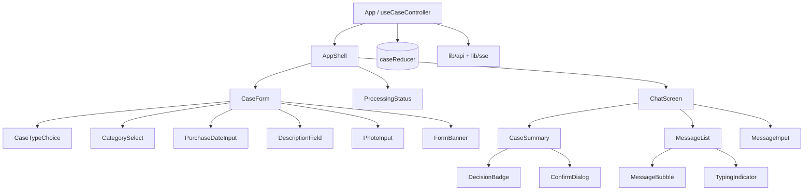
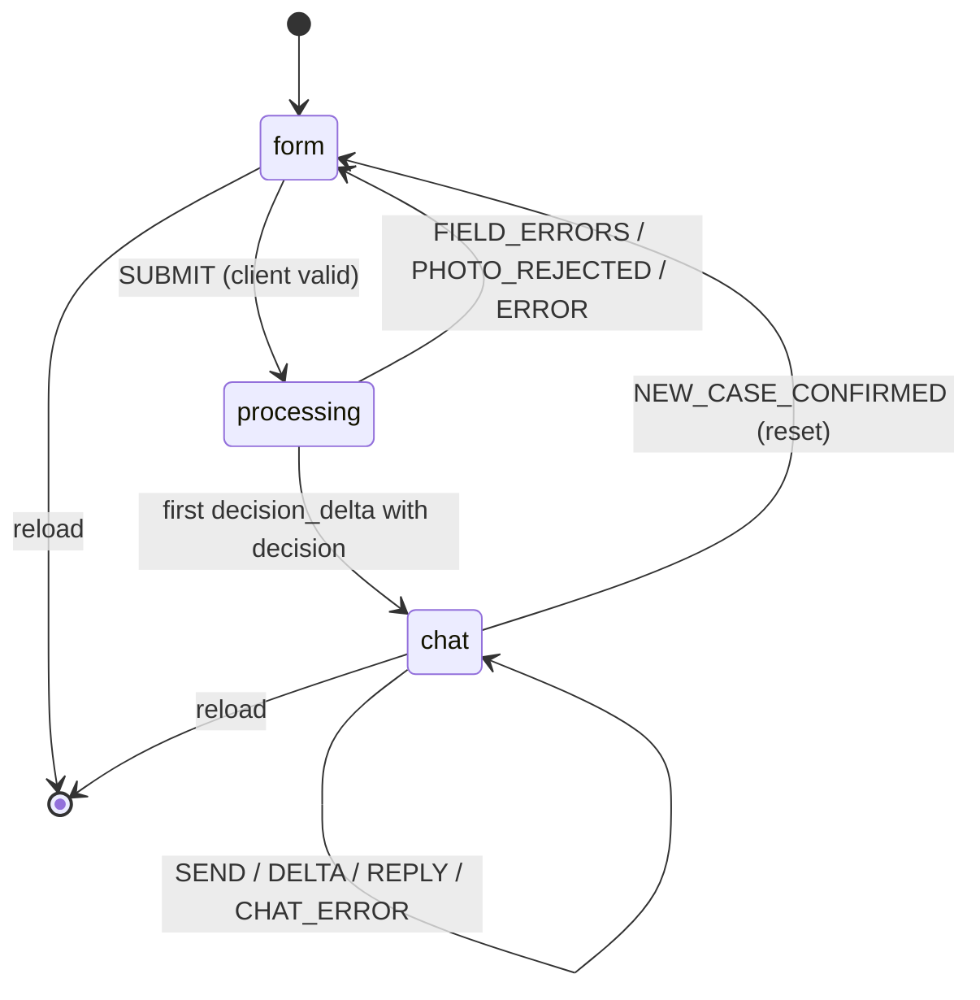
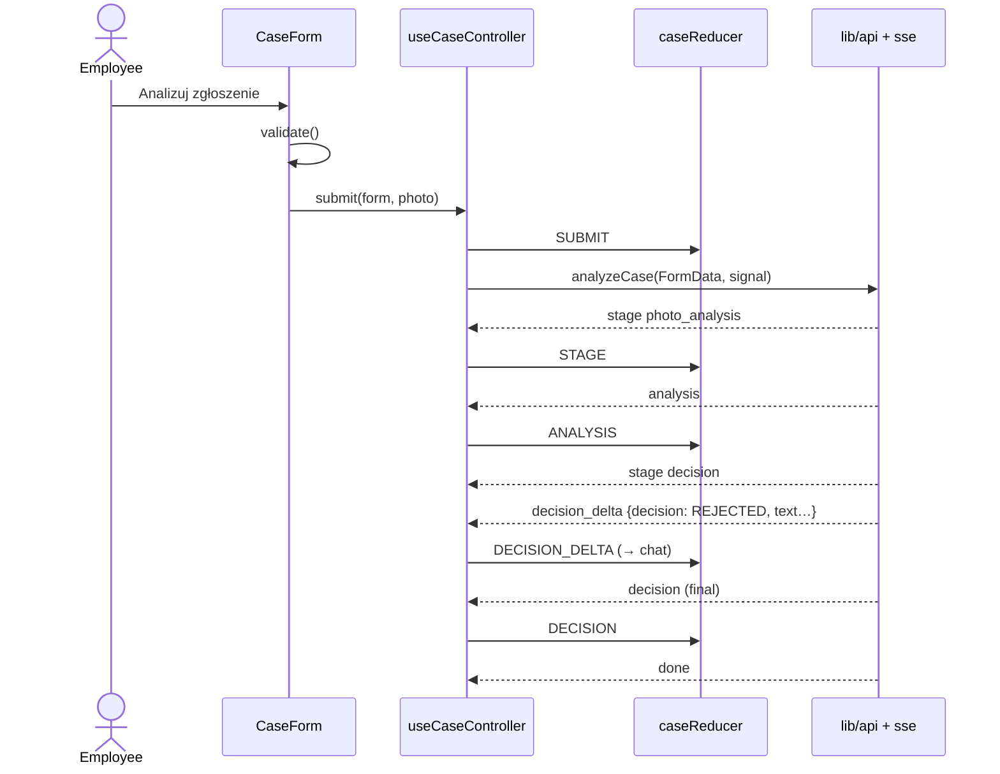

# ADR-003: Frontend (React SPA)

**Date:** 2026-10-18
**Status:** Accepted
**Relates to:** `docs/ADR/000-main-architecture.md`

---

## 1. Scope

Covers `app/frontend`: project setup, screen/state model, components, client validation, API and SSE client, Markdown rendering, styling from the brand tokens, accessibility and responsiveness, and frontend tests. Also the E2E project `app/e2e`.

Not covered: backend behaviour (ADR-001), agent logic (ADR-002).

---

## 2. Technology Documentation References

| Library | Context7 ID or official docs | Used for |
|---|---|---|
| React | `/react/react` (v19.2.x) | Components, `useReducer`, `useEffect` |
| Vite | `/vitejs/vite` | `react-ts` template, dev server, `server.proxy` for `/api`, build |
| Tailwind CSS v4 | `/tailwindlabs/tailwindcss.com` | `@tailwindcss/vite` plugin, `@theme` tokens |
| react-markdown | `/remarkjs/react-markdown` | Rendering agent Markdown without raw HTML |
| Vitest | `/vitest-dev/vitest` | Unit/component test runner (jsdom) |
| React Testing Library | `/testing-library/react-testing-library` | Component tests |
| user-event | `/testing-library/user-event` | Typing, clicking, file upload in tests |
| Playwright | `/microsoft/playwright` | E2E (`@playwright/test`), `setInputFiles` with example images |

---

## 3. Component Design

### 3.1 Project setup

- Created with Vite `react-ts` template in `app/frontend`; npm as package manager; ESLint (template config) + Prettier.
- `vite.config.ts`: React plugin, `@tailwindcss/vite`, `server.port = FRONTEND_PORT (5173)`, `server.proxy['/api'] → http://localhost:${BACKEND_PORT}` (no rewrite; SSE passes through unbuffered).
- Scripts: `dev`, `build`, `preview`, `test` (Vitest run), `lint`, `typecheck` (`tsc --noEmit`).
- No router library: three screens switched by state; no global state library.

### 3.2 State machine (`app/caseReducer`)

One reducer holds the whole `CaseSession` (ADR-000 §5):

| State | Shown | Transitions |
|---|---|---|
| `form` | Case form (optionally with `formError` banner or `photoRejected` message) | `SUBMIT` → `processing` |
| `processing` | Form read-only + progress (`stage`: `photo_analysis` \| `decision`) | `STAGE`; `ANALYSIS` (store); `DECISION_DELTA` (store partial); `DECISION` → `chat`; `PHOTO_REJECTED` → `form` (photo cleared, fields kept); `ERROR` → `form` (all kept, retry banner); `FIELD_ERRORS` (422/413/415) → `form` |
| `chat` | Chat screen | `SEND` (append employee msg, `pending`); `DELTA`; `REPLY` (append agent msg, update `currentDecision` if change); `CHAT_ERROR` (restore text in input, error note); `NEW_CASE_CONFIRMED` → `form` (empty) |

Decision when to show the first chat message: the chat screen opens on the first `decision_delta` that has a non-null `decision`, so the employee sees the answer stream in (the processing indicator stays until then). The final `decision` event replaces the streamed text.

The reducer is pure and fully unit-tested; side effects (requests, abort, object URLs) live in a `useCaseController` hook.

### 3.3 Components

| Component | Responsibility | PRD |
|---|---|---|
| `AppShell` | Header (product name + subtitle), main area, footer; brand layout | §9 |
| `CaseForm` | Fields in order, labels/hints dependent on case type, submit | AC-01…AC-12, §9.1 |
| `CaseTypeChoice` | Two large radio cards with hints | AC-02 |
| `CategorySelect` | Native `<select>` from `/api/meta` categories | AC-03 |
| `PurchaseDateInput` | Native `<input type="date">` with `max` = today (Europe/Warsaw) | AC-05 |
| `DescriptionField` | Textarea with counter "n / 2000", dynamic label | AC-06 |
| `PhotoInput` | Drop zone + file picker (`accept` JPEG/PNG/WebP), client size/type check, thumbnail via object URL, file name, "Usuń" | AC-07…AC-10 |
| `FormBanner` | Service error with "Spróbuj ponownie"; photo rejected message | AC-16, AC-34 |
| `ProcessingStatus` | Two stages with current/done markers, `aria-live="polite"` | AC-24, §9.2 |
| `ChatScreen` | Two-column ≥1024 px, stacked below with collapsible summary | §9.3 |
| `CaseSummary` | Case fields, thumbnail (click → enlarged dialog), current `DecisionBadge`, "Nowe zgłoszenie" | AC-26 |
| `MessageList` / `MessageBubble` | Agent left, employee right; Markdown via react-markdown; auto-scroll to newest | AC-25, AC-32, AC-33 |
| `DecisionBadge` | Four variants with label + icon (not colour only) | §9.3 |
| `TypingIndicator` | "pisze…" while pending | AC-28 |
| `MessageInput` | Textarea, counter, Enter sends / Shift+Enter newline, disabled while pending or empty | AC-27, AC-35 |
| `ConfirmDialog` | Native `<dialog>` for "Nowe zgłoszenie" | AC-36 |

### 3.4 API and SSE client (`lib/api`, `lib/sse`)

- `getMeta()` — `GET /api/meta`; on failure use bundled defaults (ADR-001 B3).
- `analyzeCase(form, photo, signal)` — `POST /api/cases/analyze` as `FormData`. Non-200 JSON → `FIELD_ERRORS`; 200 → parse SSE.
- `sendChat(payload, signal)` — `POST /api/cases/chat` JSON → SSE.
- `parseSse(stream)` — reads `ReadableStream<Uint8Array>` with a UTF-8 `TextDecoder` (streaming mode), splits on blank lines, supports `event:` and multi-line `data:`, ignores comments; yields `{event, data}` with JSON-parsed data. A stream that ends without `done` is treated as `ERROR`.
- Every request uses an `AbortController`; "Nowe zgłoszenie" and unmount abort in-flight requests. Client-side timeout of `LLM_TIMEOUT_SECONDS + 10` s (100 s) as a safety net.

### 3.5 Validation (`features/form/validation`)

Mirrors backend rules using limits from `/api/meta`: required fields, trimmed lengths, future-date check in Europe/Warsaw (`Intl.DateTimeFormat` with `timeZone: "Europe/Warsaw"`), description required for complaints, photo type by MIME/extension and size ≤10 MB. Server 422/413/415 messages are shown on the matching field and take precedence. On submit with errors, focus moves to the first invalid field (AC-11).

Note: the browser-reported type for `laptop-1.png` is `image/png` though the content is JPEG; the client accepts it and the backend detects the real format (ADR-001 §3.1).

### 3.6 Styling

- `src/styles/theme.css` defines `@theme` variables transcribed from `assets/design-tokens.json` (colours, font stacks, font sizes, spacing, radius 0). A unit test parses both files and asserts each colour token in the JSON has the same value in `theme.css`.
- Follow `docs/design-guidelines.md`: Georgia body text, Helvetica-style headings/navigation, black structural rules, square corners, blue links with orange-red hover, `#32373C` primary buttons.
- Decision badge colours (no brand equivalent exists): define four semantic tokens in `theme.css` — accepted, rejected, inspection, escalated — each meeting WCAG AA contrast with its text; always paired with an icon and the label.
- Layout: max content width 940 px on desktop (brand), 16 px side gutter on mobile, no horizontal scroll from 360 px to 1920 px (AC-40).

### 3.7 Text and accessibility

- All strings in `src/i18n/pl.ts` (AC-38); no inline Polish strings in components (lint-free convention checked in review).
- Labels bound to inputs; errors linked via `aria-describedby`; invalid fields `aria-invalid`.
- Chat list `role="log"` with `aria-live="polite"`; processing status `aria-live="polite"`.
- All interactive elements reachable by keyboard; visible focus outline.

---

## 4. Data Structures

TypeScript types mirror backend contracts (ADR-001 §4, ADR-002 §4): `CaseType`, `CategoryCode`, `DecisionCode`, `CaseInput`, `PhotoAnalysis`, `Decision`, `ChatMessage {id, role, content, decisionChange?}`, `ChatReply`, `SseEvent` (discriminated union by `event`), `Meta`, `FieldErrors`.

`CaseSession` (client only): `case`, `photo {file, previewUrl}`, `analysis`, `initialDecision`, `currentDecision`, `messages[]`, `pending`, `stage`, `banner`, `fieldErrors`. The photo `File` stays in memory only to allow "Spróbuj ponownie"; it is dropped (and the object URL revoked) on "Nowe zgłoszenie".

Chat payload built from state: `case`, `analysis`, `current_decision`, `messages` (as `{role, content}`), `new_message`.

---

## 5. Interface Contracts

Consumed endpoints: `GET /api/meta`, `POST /api/cases/analyze`, `POST /api/cases/chat` exactly as in ADR-001 §5. SSE event handling:

| Event | Action |
|---|---|
| `stage` | `STAGE` (update progress) |
| `analysis` | `ANALYSIS` (store) |
| `photo_rejected` | `PHOTO_REJECTED` → form, clear photo, show `message` |
| `decision_delta` | `DECISION_DELTA` (open chat on first non-null `decision`; replace streamed text) |
| `decision` | `DECISION` (final text, `initialDecision = currentDecision`) |
| `delta` | `DELTA` (replace pending agent text) |
| `reply` | `REPLY` (final text; if `decision_change` update `currentDecision`) |
| `error` | `ERROR` (analyse) or `CHAT_ERROR` (chat) with `message` |
| `done` | Close request |

---

## 6. Technical Decisions

### F1 — Reducer state machine, no router
**Status:** Accepted
**Date:** 2026-10-18
**Context:** Three screens, strictly sequential, session must vanish on reload (AC-37).
**Decision:** One `useReducer` state machine; no URL routes, no persistence.
**Rejected alternatives:**
- React Router: deep links would expose screens without state.
- Zustand/Redux: unnecessary for one session object.
**Consequences:**
- (+) All transitions unit-testable as pure functions; reload naturally resets.
- (-) Browser Back leaves the app (acceptable; no history entries are pushed).
**Review trigger:** If case history or deep links are added.

### F2 — fetch-based SSE parser
**Status:** Accepted
**Date:** 2026-10-18
**Context:** Analyse and chat are POST requests; `EventSource` supports GET only.
**Decision:** Small in-house parser over `fetch` streams, covered by unit tests.
**Rejected alternatives:**
- Third-party fetch-event-source library: extra dependency for ~50 lines of logic.
**Consequences:**
- (+) Full control over abort and error handling.
- (-) Must handle chunk boundaries and multi-byte characters (tested).
**Review trigger:** If SSE features like reconnection or `Last-Event-ID` are needed.

### F3 — Native form controls
**Status:** Accepted
**Date:** 2026-10-18
**Context:** Accessibility and mobile usability for select/date inputs; brand is minimal.
**Decision:** Native `<select>`, `<input type="date">`, `<dialog>`, styled with Tailwind.
**Rejected alternatives:**
- Custom date picker / component library: more code, more accessibility risk.
**Consequences:**
- (+) Built-in keyboard and screen-reader support; mobile pickers.
- (-) Date picker look differs across browsers.
**Review trigger:** If design requires a uniform calendar UI.

---

## 7. Diagrams

### Component Diagram

### State Diagram

### Sequence — submit to chat

---

## 8. Testing Strategy

### Test scenarios for this area

| Scenario | Type | Input | Expected output | Edge cases |
|---|---|---|---|---|
| Reducer transitions | Unit | Each action from each state | Next state per §3.2 | `PHOTO_REJECTED` keeps fields, clears photo; `ERROR` keeps photo |
| SSE parser | Unit | Chunks split mid-line and mid-UTF-8 char ("ż") | Correct events in order | Multi-line `data:`; stream ends without `done` → error |
| Validation | Unit | Boundary values (1/2/100/101 chars, 9/10 desc for complaint) | Polish messages from `pl.ts` | Today in Warsaw at 23:30 UTC |
| Tokens sync | Unit | `design-tokens.json` vs `theme.css` | All colours equal | — |
| Meta defaults sync | Unit | Bundled defaults vs. recorded `/api/meta` response captured from the running backend | Equal | — |
| Form behaviour | Component | Select "Reklamacja"/"Zwrot" | Label "(wymagane)"/"(opcjonalne)", photo hint changes | No type selected → label "Opis" |
| Photo input | Component | user-event upload of `phone-1.jpg`; a `.txt`; second file | Thumbnail + name; error for txt; second replaces first | Remove clears |
| Submit invalid | Component | Empty form | Errors under each field, focus on first, no fetch | — |
| Double submit | Component | Click twice | One request | — |
| Processing | Component | Mocked SSE stages | Stage markers update | — |
| Chat render | Component | Final decision event | Badge, Markdown rendered (no `**`), disclaimer present | — |
| Chat send | Component | Type + Enter; Shift+Enter | Message appended, "pisze…", input disabled; newline on Shift+Enter | Whitespace-only disabled |
| Decision change | Component | `reply` with change | Summary badge updates | — |
| Chat error | Component | `error` event | Text restored in input, error note, history intact | — |
| New case | Component | Confirm / cancel | Reset / unchanged; abort called | During streaming |
| E2E complaint | E2E | Real stack, Smartfon, `phone-1.jpg`, description | Chat opens with one of 4 badges, disclaimer, ≥1 "pkt" reference; follow-up question gets an answer | Do not assert what the model sees (example-images README) |
| E2E return | E2E | Laptop, `laptop-2.webp`, purchase 20 days ago | Badge "Odrzucone" (deterministic deadline) | — |
| E2E validation | E2E | Future date, missing photo | Polish errors, no request | — |
| E2E new case | E2E | After chat, Nowe zgłoszenie → confirm | Empty form | Reload → empty form |

### Technical acceptance criteria

- **TAC-003-01** `npm run typecheck`, `npm run lint`, `npm test` and `npm run build` succeed with no errors or warnings.
- **TAC-003-02** No component renders raw HTML from agent output (react-markdown without raw-HTML plugins; a test with `` in the message renders it as text).
- **TAC-003-03** At viewport widths 360, 768, 1024 and 1920 px, `document.documentElement.scrollWidth` ≤ viewport width on form and chat screens (Playwright check).
- **TAC-003-04** After "Nowe zgłoszenie" confirmation, the next analyse request body contains none of the previous case's values (component test inspects the mocked `fetch`).
- **TAC-003-05** Playwright E2E runs with zero mocked routes (`page.route` not used).
