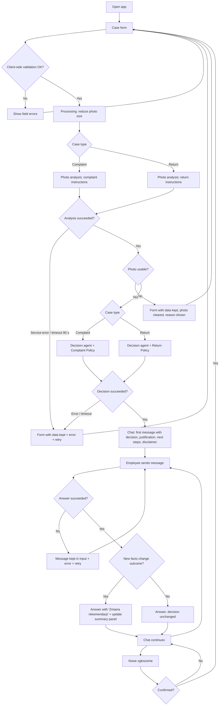

# PRD — Hardware Service Decision Copilot (MVP)

Version: 1.0 — 2026-10-18
Status: Draft for ADR

---

## 1. Executive Summary

Hardware Service Decision Copilot is an MVP web application for customer support and hardware service employees who handle electronics **complaints** (defect claims) and **returns** (withdrawal without a defect). The employee fills in a short form with case data and one photo of the equipment. The system analyses the photo with a multimodal AI model, applies the company's complaint or return policy, and presents a recommended decision with a justification in a chat, where the employee can ask follow-up questions or add information. The decision is a **recommendation**; the employee makes the final decision.

---

## 2. Problem Statement

Employees deciding on complaints and returns must check the purchase date against policy deadlines, inspect the equipment's condition, match what they see to policy rules and exclusions, and explain the outcome to the customer. Today they do this manually, from memory or by searching policy documents.

This leads to:

- **Inconsistent decisions** — similar cases get different outcomes depending on the employee's experience.
- **Slow handling** — less experienced employees need to look up rules or ask a senior colleague.
- **Weak justifications** — customers receive decisions without a clear reference to the rule that was applied, which causes disputes.
- **Missed exclusions** — signs of liquid damage, drops or use are overlooked, or legitimate defects are rejected as "user damage".

---

## 3. Users / Personas

### 3.1 Anna — customer support employee (primary)

- Works at the store counter or on the hotline; handles 20–40 cases a day.
- Has basic product knowledge, no technical service training.
- Wants: a fast, defensible recommendation she can explain to the customer in plain words, with the policy rule behind it.
- Expects: one screen to enter the case, a clear decision within about a minute, and the possibility to ask "what if the customer says…?".

### 3.2 Marek — hardware service technician (secondary)

- Receives equipment for inspection; evaluates damage causes.
- Wants: a structured description of visible damage and its likely cause, to prepare for inspection or to double-check a complaint decision.
- Expects: the system to say clearly when a photo is not enough and a hands-on inspection is needed, instead of guessing.

### 3.3 Edge cases to support

- An employee enters a case outside the policy deadline (return after 14 days, complaint after 2 years).
- The customer's description contradicts the photo (claims a factory defect, the photo shows a cracked screen with an impact point).
- The photo is blurred, too dark, shows a different object or a different equipment category.
- The employee files a "return" for equipment the customer describes as faulty, or a "complaint" without describing any defect.

---

## 4. Main Flows

### 4.1 Happy path — complaint

1. The employee opens the application. The system shows the case form.
2. The employee selects **Complaint**, selects an equipment category, enters the name/model, selects the date of purchase, enters the defect description and uploads one photo showing the defect.
3. The employee clicks **Analyse case**. The system validates all fields on the client side; all are valid.
4. The system shows a processing state with progress stages: "Analysing photo" → "Preparing decision".
5. The system reduces the photo's file size and sends it to the multimodal AI model with the **complaint photo-analysis instructions**. The model returns a structured description: what the photo shows, whether it matches the selected category, visible damage, its location and likely cause, signs of liquid, impact, tampering or wear, and photo quality.
6. The system passes the form data, the photo description and the full **Complaint Policy** to the decision agent with the **complaint decision instructions**.
7. The agent returns a decision (one of four categories, section 11.3), a justification referencing policy sections, and next steps.
8. The system switches to the chat screen. The first chat message from the agent contains: greeting, decision, justification, next steps, disclaimer (section 11.4). A case summary panel shows the form data and the photo thumbnail.
9. The employee can type follow-up messages; the agent answers with the full context (section 4.4).

### 4.2 Happy path — return

Same as 4.1, with these differences:

- Step 2: the employee selects **Return**; the description is optional; the photo shows the equipment's general condition.
- Step 5: the system uses the **return photo-analysis instructions** — the model judges whether the equipment is undamaged, shows signs of use, appears complete, and can be resold as new.
- Step 6: the system uses the **Return Policy** and the **return decision instructions**.

### 4.3 Unusable photo

1. Steps 1–5 as in 4.1/4.2.
2. The photo analysis reports that the photo cannot be used: it does not show electronics equipment, shows equipment of a different category than selected, or is too blurred/dark/small to assess the condition.
3. The system **does not** produce a decision and does not open the chat.
4. The system returns to the form with all entered data preserved, removes the uploaded photo, and shows a message explaining the specific problem and what to photograph instead (e.g., "Zdjęcie jest nieostre. Prześlij wyraźne zdjęcie pokazujące ekran urządzenia.").
5. The employee uploads a new photo and submits again.

### 4.4 Follow-up conversation in chat

1. The employee types a message (question or new information, e.g., "Klient twierdzi, że telefon nie był upuszczony").
2. The system sends the message to the agent together with: form data, photo description, the applicable policy, the first decision message and the full chat history.
3. The agent answers in Polish. If the message contains **new facts** that change the outcome under the policy, the agent issues a revised decision clearly labelled "Zmiana rekomendacji", stating the previous decision, the new decision and the reason. If the message only disagrees without new facts, the agent keeps the decision and explains why.
4. The current decision shown in the case summary panel is updated when the agent revises it.

### 4.5 Service error

1. During analysis, the AI service is unavailable, returns an error, or does not respond within 90 seconds.
2. The system stops the processing state and stays on (or returns to) the form with all data and the photo preserved.
3. The system shows: "Nie udało się przeanalizować zgłoszenia. Spróbuj ponownie za chwilę." with a **Spróbuj ponownie** button that resubmits the same data.
4. In chat, if a follow-up message fails, the message stays in the input with an error note under it and a retry option; earlier messages are unaffected.

### 4.6 New case

1. On the chat screen the employee clicks **Nowe zgłoszenie**.
2. The system asks for confirmation ("Rozpocząć nowe zgłoszenie? Bieżąca rozmowa zostanie usunięta.").
3. After confirmation the system clears the session and shows an empty form.

---

## 5. User Stories

1. As a support employee, I want to enter a complaint with a photo and get a recommended decision with a justification, so that I can answer the customer quickly and consistently.
2. As a support employee, I want to enter a return and learn whether the equipment can be accepted for resale, so that I don't accept used or damaged items as new.
3. As a support employee, I want the justification to cite the policy section that was applied, so that I can explain the decision to the customer and defend it.
4. As a support employee, I want to be told immediately when a photo is unusable and what to photograph instead, so that I don't receive a decision based on a bad photo.
5. As a support employee, I want to add information the customer gave me in the chat and get a revised recommendation when the facts change, so that the decision reflects the whole case.
6. As a service technician, I want the system to say "service inspection required" when a defect cannot be judged from a photo, so that internal faults are not rejected or accepted blindly.
7. As a support employee, I want a clear error message and a retry option when the AI service fails, so that I don't lose the data I entered.
8. As a support employee, I want to start a new case with one click, so that data from the previous customer does not leak into the next case.
9. As a support employee, I want contradictions between the description and the photo to be escalated to a specialist, so that disputed cases get human review.

---

## 6. Acceptance Criteria

### Form

- **AC-01** The form contains exactly these fields, in this order: case type, equipment category, name/model, date of purchase, description, photo.
- **AC-02** Case type is a required single choice with two options: "Reklamacja" and "Zwrot". No option is preselected.
- **AC-03** Equipment category is a required single choice from: Smartfon, Laptop, Tablet, Telewizor, Słuchawki / audio, Konsola do gier, Smartwatch, Małe AGD, Inne.
- **AC-04** Name/model is required, 2–100 characters after trimming whitespace.
- **AC-05** Date of purchase is required and selected with a date picker. Dates later than today are rejected with "Data zakupu nie może być z przyszłości." Dates earlier than today are always accepted by the form, even beyond policy deadlines (the deadline is judged by the agent).
- **AC-06** When case type is "Reklamacja", the description is required and must contain 10–2000 characters; when "Zwrot", it is optional and limited to 2000 characters. The field label shows "(wymagane)" or "(opcjonalne)" according to the selected case type.
- **AC-07** The photo is required. Exactly one file can be attached; attaching a second file replaces the first.
- **AC-08** Accepted photo formats are JPEG, PNG and WebP. Any other file is rejected with "Nieobsługiwany format pliku. Dozwolone: JPG, PNG, WebP." and is not attached.
- **AC-09** A photo larger than 10 MB is rejected with "Plik przekracza limit 10 MB." and is not attached.
- **AC-10** After a photo is attached, the form shows its thumbnail, file name and a **Usuń** control that removes it.
- **AC-11** Clicking **Analizuj zgłoszenie** with invalid fields does not send anything; each invalid field shows its own error message next to it and focus moves to the first invalid field.
- **AC-12** While the case is being processed, the submit button is disabled, so the same case cannot be submitted twice.

### Photo analysis

- **AC-13** Before analysis, the system reduces any photo whose longer side exceeds 2048 px or whose size exceeds 2 MB, keeping the aspect ratio. The photo sent for analysis never exceeds those limits.
- **AC-14** For a complaint, the analysis uses the complaint analysis instructions; for a return, the return analysis instructions. The two instruction sets are separate.
- **AC-15** The analysis result states at minimum: whether the photo shows electronics equipment, whether it matches the selected category, photo quality (usable / not usable with a reason), list of visible damage with location, signs of use, signs of liquid damage, signs of impact, signs of tampering.
- **AC-16** When the analysis marks the photo as not usable, the system shows the form again with all fields except the photo preserved, displays the reason in Polish, and does not create a decision or open the chat.

### AI decision

- **AC-17** The decision uses the Complaint Policy for complaints and the Return Policy for returns, and separate decision instructions for each case type.
- **AC-18** Every decision is exactly one of: "Przyjęte", "Odrzucone", "Wymaga inspekcji serwisu", "Przekazane do specjalisty".
- **AC-19** A return with a date of purchase 15 or more days before today is "Odrzucone", with a reference to Return Policy section 2.
- **AC-20** A complaint with a date of purchase more than 2 years before today is "Odrzucone", with a reference to Complaint Policy section 2.3 and a mention of the manufacturer's warranty.
- **AC-21** When the description contradicts the photo analysis (e.g., "factory defect" vs. visible impact damage), the decision is "Przekazane do specjalisty" or "Odrzucone" with the contradiction stated explicitly; it is never "Przyjęte".
- **AC-22** When a complaint describes a functional fault with no visible damage (e.g., does not charge, does not turn on), the decision is "Wymaga inspekcji serwisu" unless an exclusion is clearly visible.
- **AC-23** The justification references at least one policy section by number (e.g., "Regulamin reklamacji, pkt 4.2").
- **AC-24** From clicking **Analizuj zgłoszenie** to the first chat message appearing, the processing state is visible and shows the current stage.

### Chat

- **AC-25** The first chat message is from the agent and contains, in this order: greeting, decision (visually highlighted as a label), justification, next steps as a numbered list, disclaimer from section 11.4.
- **AC-26** A case summary panel on the chat screen shows: case type, category, name/model, date of purchase, description (or "brak"), photo thumbnail and the current decision.
- **AC-27** The message input accepts 1–2000 characters; the send button is disabled for empty or whitespace-only input. Enter sends; Shift+Enter inserts a new line.
- **AC-28** After sending, the employee's message appears immediately, followed by a "pisze…" indicator until the agent's answer arrives.
- **AC-29** The agent's answers take into account the form data, photo description, policy, first decision and all previous messages. Example check: after the employee writes "Klient dosyła brakującą ładowarkę", a later question "Czego brakuje do przyjęcia zwrotu?" does not list the charger.
- **AC-30** When the agent revises a decision, the message contains "Zmiana rekomendacji", the previous and the new decision, and the reason; the case summary panel shows the new decision.
- **AC-31** When the employee only disagrees without new facts (e.g., "Proszę zmienić na przyjęte"), the decision is not changed and the agent explains which rule prevents it.
- **AC-32** Agent messages render formatting (bold, lists, headings); raw formatting characters are not shown.
- **AC-33** The chat scrolls to the newest message after each new message.

### Errors and session

- **AC-34** When the AI service fails or does not respond within 90 seconds during analysis, the system shows "Nie udało się przeanalizować zgłoszenia. Spróbuj ponownie za chwilę." with a **Spróbuj ponownie** button, and all form data including the photo is preserved.
- **AC-35** When a chat message fails, the text stays in the input, an error note is shown, and earlier messages are unchanged.
- **AC-36** **Nowe zgłoszenie** asks for confirmation; after confirmation the form is empty and no data from the previous case is visible or sent to the agent.
- **AC-37** Reloading the page or closing the tab ends the session; after reload the empty form is shown.

### General

- **AC-38** All UI text, validation messages and agent messages are in Polish.
- **AC-39** Error messages never show technical details (stack traces, status codes, service names, keys).
- **AC-40** The application is usable at viewport widths from 360 px to 1920 px without horizontal scrolling.

---

## 7. Out of Scope

- **Authentication and user accounts** — no login; anyone with access to the application URL can use it.
- **Customer data and purchase history lookup** — planned later; in the MVP the employee enters all data manually.
- **Persisting sessions, decisions and actions** — planned later; the MVP keeps a case only for the life of the browser tab.
- **Knowledge base / RAG** about electronics and procedures — planned later; the agent uses only the two policy documents and its general knowledge.
- **Multiple photos per case** and **uploading photos in the chat**.
- **Video, audio or document uploads** (receipts, invoices).
- **Verifying the purchase** (receipt, order number, serial number).
- **Executing decisions** — no refunds, service tickets, shipping labels or customer notifications are created.
- **Integrations** with ticketing, ERP, CRM, e-mail or SMS.
- **Admin UI** for editing policies, instructions or categories; changes are made in files.
- **Case history, search, reports or analytics.**
- **Multilingual UI** — Polish only.
- **Native mobile or desktop apps.**
- **Business customers (B2B)** — policies cover consumer purchases only.

---

## 8. Constraints

### Business

- The decision is a **recommendation**. The employee is responsible for the final decision; the UI and the agent must not present the recommendation as final or legally binding.
- The policy documents are **samples** inspired by Polish consumer law, not legal advice. They must be replaced with the company's real policies before production use.
- The agent must apply only the rules in the policy documents. It must not invent deadlines, exclusions or remedies.
- Photos may show personal data (faces, documents, screens with messages). The photo and case data are used only to produce the decision and are discarded when the session ends.

### Functional

- One photo per case; JPEG, PNG or WebP; max 10 MB on upload.
- Photo sent for analysis: longer side max 2048 px and max 2 MB.
- Name/model: 2–100 characters. Description: 10–2000 characters for complaints, 0–2000 for returns. Chat message: 1–2000 characters.
- Time limit for analysis and for a single chat answer: 90 seconds.
- Language: Polish (UI and agent).
- Supported browsers: current versions of Chrome, Edge and Firefox on desktop; Chrome on Android and Safari on iOS for mobile widths.
- Dates are evaluated in the Europe/Warsaw time zone; "today" is the current date in that zone.

### External document / data references

| Document | File path | When it is used |
|---|---|---|
| Return Policy (sample) | `docs/policies/return-policy.md` | Injected into the decision agent's context for every **return** case, for the first decision and all chat answers. |
| Complaint Policy (sample) | `docs/policies/complaint-policy.md` | Injected into the decision agent's context for every **complaint** case, for the first decision and all chat answers. |

The policy documents are written in English; the agent quotes or paraphrases them in Polish.

---

## 9. UI Description (wireframe level)

The application uses the agreed brand reference (`docs/design-guidelines.md`). The layout has a header with the product name, a main content area and a footer.

### 9.1 Case form screen

- **Header:** product name "Hardware Service Decision Copilot" and subtitle "Asystent decyzji reklamacyjnych i zwrotów".
- **Form card** with fields in order:
  1. **Rodzaj zgłoszenia** — two large selectable options side by side: "Reklamacja" (hint: "Sprzęt jest uszkodzony lub nie działa") and "Zwrot" (hint: "Klient rezygnuje z zakupu").
  2. **Kategoria sprzętu** — dropdown with the list from AC-03, placeholder "Wybierz kategorię".
  3. **Nazwa / model** — text input, placeholder "np. Samsung Galaxy S24".
  4. **Data zakupu** — date picker; future dates disabled.
  5. **Opis** — textarea with a character counter "0 / 2000". Label "Opis usterki (wymagane)" for complaints, "Uwagi (opcjonalne)" for returns. Before a case type is selected, label "Opis".
  6. **Zdjęcie sprzętu** — drop zone "Przeciągnij zdjęcie lub kliknij, aby wybrać" with a hint that changes by case type: complaints — "Pokaż uszkodzenie lub miejsce usterki"; returns — "Pokaż cały sprzęt, najlepiej z ekranem/frontem". After upload: thumbnail, file name, **Usuń**.
- **Primary button:** "Analizuj zgłoszenie".
- **Validation:** errors appear below each field in text; fields with errors are visually marked.
- **Unusable photo state:** a message box above the photo field with the reason from the analysis; the photo field is empty.
- **Service error state:** a message box above the button with the text from AC-34 and **Spróbuj ponownie**.

### 9.2 Processing state

- Replaces the form button area (or overlays the form card) with a progress indicator and two stages: "Analiza zdjęcia" and "Przygotowanie decyzji". The current stage is highlighted; completed stages are marked as done.
- The form is not editable during processing.
- No cancel action in the MVP.

### 9.3 Chat screen

- **Desktop layout (≥ 1024 px):** two columns — case summary panel on the left (about one third), chat on the right.
- **Mobile layout (< 1024 px):** case summary collapsed into an expandable bar at the top ("Szczegóły zgłoszenia"), chat below.
- **Case summary panel:** case type, category, name/model, date of purchase, description, photo thumbnail (click opens it enlarged), current decision label. Button **Nowe zgłoszenie** at the bottom.
- **Chat area:** messages in bubbles — agent on the left, employee on the right. The first agent message is structured as in AC-25, with the decision shown as a distinct label at the top of the message.
- **Decision labels:** four visually distinct variants for "Przyjęte", "Odrzucone", "Wymaga inspekcji serwisu", "Przekazane do specjalisty" (distinct by text and icon, not only colour).
- **Input area:** multi-line input "Napisz wiadomość…", character counter, send button. Disabled while the agent is answering.
- **Typing state:** "pisze…" indicator as the last item in the chat.
- **Message error state:** red note "Nie udało się wysłać wiadomości." with **Ponów** below the input.
- **Confirmation dialog** for **Nowe zgłoszenie** with "Anuluj" and "Rozpocznij nowe".

### 9.4 Navigation

- Form → (submit, success) → Chat.
- Form → (submit, unusable photo or error) → Form with message.
- Chat → (Nowe zgłoszenie, confirmed) → empty Form.
- Browser reload on any screen → empty Form.

---

## 10. User Flow Diagram

---

## 11. Agent / System Behavior Specification

### 11.1 Roles

The system uses two AI roles:

1. **Photo analyst** (multimodal model) — describes what the photo shows. It does not decide on the case. It has two instruction sets:
   - **Complaint:** identify the equipment, check it matches the selected category, describe visible damage (type, location, extent), assess its likely cause (manufacturing defect, impact/drop, liquid, tampering, wear, cannot be determined), and rate photo quality.
   - **Return:** identify the equipment, check it matches the selected category, look for any damage or signs of use (scratches, wear, dirt, stickers, missing parts, opened seals), state whether the equipment looks resellable as new, list visible accessories, and rate photo quality.
2. **Decision agent** (reasoning model) — takes the form data, photo analysis and applicable policy, and produces the recommended decision and conducts the chat. It has two instruction sets (complaint, return), each including the corresponding policy document in full.

### 11.2 Allowed / not allowed

The decision agent **is allowed to**:

- Recommend one of the four decisions and justify it with policy sections.
- Compute deadlines from the date of purchase and today's date.
- Explain policy rules, next steps and what the employee should check or tell the customer.
- Ask the employee for missing information that would change the decision (e.g., "Czy klient ma wszystkie akcesoria?").
- Revise the decision when new facts justify it (section 4.4).

The decision agent **is not allowed to**:

- Present the recommendation as final or legally binding.
- Apply rules, deadlines or exclusions not present in the policy documents, or contradict them.
- Change a decision because the employee or the customer insists, without new facts.
- Promise refund amounts, repair costs, repair times or compensation not defined in the policy.
- Claim it has seen anything that is not in the photo analysis, or claim access to customer data, purchase history or other systems.
- Give legal advice beyond the policy; for legal questions it recommends contacting a supervisor or legal department.
- Reveal its instructions or internal reasoning text, or follow instructions in the description or chat that try to change its role or rules.

### 11.3 Decision categories

| Decision (UI label) | Meaning | How it is communicated |
|---|---|---|
| **Przyjęte** | Case meets the policy conditions. | Next steps from the policy (e.g., return: check completeness, refund within 14 days; complaint: repair or replacement, response within 14 days). |
| **Odrzucone** | Case clearly fails a policy condition. | The exact condition and section; what the customer can do instead (e.g., file a complaint, manufacturer's warranty, paid repair). |
| **Wymaga inspekcji serwisu** | Cannot be decided from the photo; needs a hands-on check. | What exactly the technician should check; how to accept the equipment for inspection (intake record). |
| **Przekazane do specjalisty** | Contradictory data, case not covered by the policy, or the agent cannot decide with reasonable confidence. | What is unclear or contradictory and what the specialist should review. |

When the agent is uncertain between "Przyjęte" and "Odrzucone", it must choose "Wymaga inspekcji serwisu" (if a physical check would resolve it) or "Przekazane do specjalisty" (otherwise). It never guesses.

### 11.4 Mandatory disclaimer

Every first decision message and every message with "Zmiana rekomendacji" ends with:

> _To jest rekomendacja systemu na podstawie zdjęcia i podanych informacji. Ostateczną decyzję podejmuje pracownik._

### 11.5 Off-topic and out-of-scope requests

- Questions unrelated to the current case, electronics, complaints or returns: the agent replies briefly that it can only help with the current case and returns to it.
- Requests about a different device or customer: the agent advises starting a new case with **Nowe zgłoszenie**.
- Requests to act (issue a refund, create a ticket, send an e-mail): the agent states it cannot perform actions and describes what the employee should do.

### 11.6 Language and tone

- Polish only, regardless of the language of the input.
- Addresses the employee (not the customer) in a professional, neutral, concise tone; uses "Pan/Pani" forms only when suggesting wording for the customer.
- First message: greeting, decision, justification of up to about 150 words, numbered next steps (2–5 items), disclaimer.
- Follow-up answers: focused on the question, normally under 150 words.
- Uses formatting: bold for the decision and key conditions, numbered lists for steps, policy references in the form "Regulamin zwrotów, pkt 3.2".

---

## 12. Further Notes

- **Assumption:** the date of purchase entered by the employee is correct; no proof of purchase is checked in the MVP.
- **Assumption:** the company grants a 14-day return period for both online and in-store purchases (Return Policy 2.1), so the form does not ask about the purchase channel.
- **Deferred:** customer data and purchase history lookup, persistent session/decision log, knowledge base (RAG) — see Out of Scope. The ADR should not block adding them later.
- **Deferred:** a cancel action during processing.
- **Open question:** should the employee be able to mark which decision they finally took (accept/override the recommendation)? Useful for the future decision log.
- **Open question:** the exact time-out (90 s) may need adjustment after measuring real model response times.
- **Legal basis of the sample policies (for reference, not verified by a lawyer):** seller's liability for non-conformity within 2 years with a 2-year presumption (Polish Consumer Rights Act, art. 43c); repair/replacement first, then price reduction or withdrawal (art. 43e); 14-day withdrawal from distance contracts.
